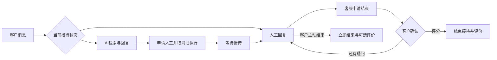

# AI客服与业务扩展

客服应用分别配置品牌、接待人员、模型、知识、网站入口和Telegram机器人。一个应用对应一个独立AI身份；管理员私聊继续使用成员关系授权，不会因拥有客服权限而开放其他人的私聊。

## 配置与使用

客服应用、知识库、访客管理沿用系统标准列表：搜索区提供查询与重置，表头提供刷新、密度、全屏和列设置，支持勾选后批量删除。新增与编辑使用标准弹窗，知识录入保留文本/网址与结果双栏。

1. 在后台的客户服务中创建客服应用，配置名称、品牌头像、客服人员和接待容量
2. 选择模型协议，配置模型名称、接口地址与密钥，再启用AI接待
3. 在知识库中添加问答，或导入文本、Markdown、公开网页；导入结果先进入待审核状态
4. 审核并发布条目，选择参考知识回答或固定原文回复
5. 配置向量服务并重建索引，随后复制应用的聊天链接或悬浮脚本

Markdown与网页按章节、段落分块，代码围栏保持完整，标题使用“文档名-章节名”，同章节多段追加序号，自动目录不作为答案导入。资料重新导入且内容或分段规则发生变化时，旧的已发布分块会原子停用，新分块进入待审核，避免旧答案与新答案同时生效。内容与分段规则未变化时保留当前发布状态。删除资料来源后，其分块立即退出检索。知识库管理者的应用选项只返回数据范围内的ID和名称，不需要应用配置权限。

应用表单的短字段使用双栏，说明统一放在控件下方；内容区可滚动但隐藏滚动条。网站入口按折叠分组管理。扩展能力显示工具与Skills列表，JSON配置和Skills安装使用独立弹窗；新增与编辑布局一致，需要应用ID的操作在保存后开放。

身份签名密钥与机器人Token可由具有应用修改权限、且处于应用数据范围内的管理员按需查看或复制。回答模型的Key不提供回显；新增或提交新Key时，系统使用本次配置发起真实模型请求，验证失败不会保存应用、密钥或版本。留空保持原Key；修改其他配置不会重复检查旧Key。新Key验证可能产生少量模型调用费用。

回答模型与向量服务使用各自的密钥，保存在应用的加密配置中，访客接口不返回模型、工具和密钥配置。拥有应用配置权限的管理员可以指定模型及连接器地址，该权限应分配给可信的配置人员。

示例官网在后端HTTP服务的`/`提供注册、登录与客服演示，后台前端仍通过自己的前端服务或域名访问。安装初始化创建公开标识为`dawn`的演示应用，读取部署目录中的Dawn和PrismGo中文文档作为已发布知识；已存在应用时不覆盖配置。只部署二进制时，可另外部署`docs`目录或在后台导入资料。默认关闭AI，配置接口与密钥后再开启，人工接待可以独立使用。

本地默认官网地址为`http://localhost:5123/`，后台为`http://localhost:5173/`。官网源码在`app/web/assets`，由`app/web/web.go`注册首页与资源，通过Go embed随二进制部署，业务可直接修改，无需另建官网项目。主题按钮以电脑、太阳、月亮图标循环切换跟随系统、亮色、暗色，并同步客服悬浮窗口。

官网的AI正文链接和参考资料通过接入方的`linkRules`把官方GitHub Pages文档映射到同站`/docs/`，保留查询参数及章节锚点；知识库保留原始来源，Telegram及其他接入网站不受影响。官网常驻外壳承载文档，点击引用后客服窗口继续保留。公开接入参数见[悬浮入口](chat.md#悬浮入口)。

访客聊天、后台客服和管理员私聊均支持Markdown标题、列表、引用、链接、表格及代码块，流式回复按已显示内容同步解析。原始HTML按文本显示，Markdown图片保持文本，不自动加载外部图片；表情保持行内对齐。渲染源码统一在dawn-admin的`src/dawn/markdown.ts`与`markdown.css`，修改后在dawn-admin执行`pnpm build:chat-assets ../dawn-server/support/customer/web`同步访客静态资源，再构建两端。

## 模型协议与推理强度

| `config.model_protocol` | 请求协议 | 推理参数 |
|---|---|---|
| `responses`（默认） | OpenAI Responses | `reasoning.effort` |
| `chat_completions` | OpenAI Chat Completions | `reasoning_effort` |
| `anthropic` | Anthropic Messages | `thinking`与`output_config.effort` |

三种协议共用知识检索、工具授权、Agent Skills、流式推送和人工草稿。完整保留工具调用上下文，Anthropic保留思考块签名；推理过程不会作为客服答复展示。

`base_url`填写API基地址，例如`https://api.example.com/v1/`。仅填写域名时补充`/v1`，自定义路径保持原样。Anthropic SDK自行添加`v1/messages`，适配器避免重复拼接`v1`。密钥只填在密钥字段中。

新建应用的推理强度默认`low`。`reasoning_effort`使用自由输入，表单提供OpenAI和Anthropic常见值快捷填入；支持服务自定义名称，留空表示使用模型默认，OpenAI可选`none/minimal/low/medium/high/xhigh/max`，具体支持范围由模型决定。Anthropic留空不额外配置思考，`none`关闭思考，其他档位使用自适应思考；旧模型不支持自适应时保持默认。配置不会在服务拒绝参数时静默更换档位或协议。

`max_output_tokens`为0时，Responses和Chat Completions不额外限制服务输出，Anthropic使用8192；填写正数时发送对应协议的输出上限。推理也可能消耗输出额度，上限过低会造成没有正文或输出中断。执行记录保存脱敏的服务错误、HTTP状态和上游请求编号，访客只接收通用提示。

保存应用后可点击“测试已保存的模型配置”，验证真实流式文本及工具调用往返。也可在dawn-simple仓库执行：

```sh
go run . dawn:model-check 1
go run . dawn:model-check 1 --queue
```

`--queue`通过实际Horizon队列执行检查，并保存一条诊断执行记录；成功结果含`tool_tested: true`。检查不创建聊天，也不修改应用配置。

访客可重试当前AI接待、当前问题中失败或中断的回复，不会重复创建客户消息。已经转人工或产生新问题时，旧回复不能重新发送。更换协议后需要重新提问，运行中的工具上下文不会跨协议重放。

空回复气泡显示正在回复、回复已停止等状态，保持正常消息高度。失败或中断时，气泡右侧显示红色重试图标，点击后重新请求回复。

## 知识检索与换模型

知识按应用隔离。条目保存适用条件、来源、版本和协助人员；草稿与停用条目不参与检索。知识管理默认展示全部状态，可筛选已发布、待审核或停用，搜索同时检查标题、关键词和正文。固定原文条目由模型选择条目后直接使用审核答案，参考条目用于组织回答并记录引用。模型无法确定条件时应澄清或转人工。

内置关键词检索同时匹配标题、关键词和正文，中文采用二字切分，保留英文API标识，按词频、区分度和内容长度排序，并限制单一来源占用的候选数，再补充主要来源的关联章节，避免漏掉同文档的调用方法。有活动向量索引时合并语义和关键词候选。模型可调用`search_knowledge(query)`，结合聊天历史改写追问、换关键词补查，再调用`knowledge(id)`选择依据并记录引用；未命中候选不等于知识库没有相关文档。应用的提示词用于说明产品定位，历史AI回复不能当作已验证知识。

示例官网的Dawn与PrismGo文档按产品、章节区分标题。更新本仓库文档后，在dawn-simple执行`go run . app:support-docs`同步并发布官方演示文档。此命令保留来源ID，停用旧分块，不修改应用模型配置、聊天记录或其他应用的知识；普通接入应用通过自己的知识来源导入与审核流程维护内容。

配置中的模型和维度表示下一次索引构建的目标。查询使用已经完成的活动索引规格，不会拿新模型去查询旧向量。重建完成并确认知识版本未变化后才切换活动索引，失败时保留旧索引。旧索引进入延迟清理任务，避免无限累积。删除或修改已发布条目后，旧索引中的对应版本不会继续用于匹配；重建前仍可使用关键词检索。

填写向量模型不代表索引已经可用。配置页未显示活动索引时使用关键词检索，需要启动向量服务并完成“重建知识索引”后才会使用向量检索。

| 存储方式 | 向量存储与检索 | 用法 |
|---|---|---|
| 通用存储 | BLOB保存向量，Go计算相似度并结合关键词 | SQLite、MySQL、MariaDB和PostgreSQL均可使用，适合较小知识库 |
| MariaDB原生索引 | `VECTOR(N)`与向量索引 | 需要支持向量功能的MariaDB版本，选择`mariadb`驱动 |
| MySQL 9.7 | `VECTOR`可存储向量，距离计算及索引能力取决于发行产品 | 普通MySQL部署使用通用存储；不能把HeatWave或MySQL AI的能力当作Community默认能力 |
| 外部知识系统 | 开发者注册检索器 | 自行连接已有知识平台或向量数据库 |

MariaDB的原生向量能力见[官方文档](https://mariadb.com/docs/server/reference/sql-structure/vectors)，MySQL各产品的向量函数差异见[官方文档](https://dev.mysql.com/doc/refman/9.7/en/vector-functions.html)。

```go
options.Customer = func(m *customer.Manager) {
    m.RegisterRetriever("external", func(ctx context.Context, appID uint, query string) ([]customer.Evidence, error) {
        // 必须限制为appID所属的数据，并返回已发布的知识与引用
        return knowledgeClient.Search(ctx, appID, query)
    })
}
```

使用注册名称作为`config.index_driver`。自定义检索器负责自己的索引构建，内置重建入口处理通用存储与MariaDB原生索引。

## 本地向量服务

扩展通过Go embed携带Python脚本和依赖清单，不依赖仓库位置。在使用Dawn的项目根目录执行：

```sh
go run . dawn:embedding install
go run . dawn:start embedding
```

安装命令将工具释放到`storage/support/embedding`，使用`EMBEDDING_PYTHON`（默认`python3`，要求Python 3.10+）创建该目录下的`.venv`并安装依赖。重复安装更新脚本及依赖，不清空虚拟环境或模型缓存。普通启动不会安装依赖。

`dawn:start embedding`复用已有管理器，支持`status`、`stop`、`restart`。设置`EMBEDDING_ENABLED=true`后随`all/local`启动，默认保持可选。Go子进程管理Python进程，首次下载和加载模型时显示等待就绪，`/health`成功后标记运行中；关闭管理器会一起回收Python进程。依赖在安装时下载，权重在首次模型启动时下载。

使用方在`dawn.embedding`注册以下配置，示例项目已提供对应`.env`：

| 环境变量 | 默认值 | 用途 |
|---|---|---|
| `EMBEDDING_ENABLED` | `false` | 随all/local启动 |
| `EMBEDDING_DIRECTORY` | `storage/support/embedding` | 工具、虚拟环境及模型缓存目录 |
| `EMBEDDING_PYTHON` | `python3` | 创建虚拟环境的解释器，可填写绝对路径 |
| `EMBEDDING_HOST` / `EMBEDDING_PORT` | `127.0.0.1` / `8852` | 监听地址与端口 |
| `EMBEDDING_MODEL` | `Qwen/Qwen3-Embedding-0.6B` | 进程加载的模型 |
| `EMBEDDING_THREADS` | `4` | CPU线程数 |
| `EMBEDDING_MAX_LENGTH` | `2048` | 输入上下文上限 |
| `EMBEDDING_DEVICE` | `cpu` | Sentence Transformers运行设备 |

常见模型包括`Qwen/Qwen3-Embedding-0.6B`、`Qwen/Qwen3-Embedding-4B`、`Qwen/Qwen3-Embedding-8B`、`BAAI/bge-m3`、`intfloat/multilingual-e5-small`，可在表单中点击复制。服务每个进程只加载一个模型，表单名称须与`EMBEDDING_MODEL`一致；填写名称不会自动下载或切换模型。修改运行配置后重启向量服务，再重建应用知识索引。

应用填写向量地址`http://127.0.0.1:8852/v1/`。Qwen3-Embedding-0.6B维度可选32～1024，建议先使用1024；同一份权重截取输出并归一化，不需要下载多套权重，也不会按维度同比减少模型占用。参考[模型官方说明](https://huggingface.co/Qwen/Qwen3-Embedding-0.6B)，其他模型按各自维度与截断能力配置。

4核8GB可作为低并发CPU部署的起点，实际吞吐和峰值内存取决于文本长度及同机进程。服务默认只监听本机；仅部署Go二进制也包含脚本，但安装环境仍需Python。已有远程OpenAI兼容向量服务可以直接接入。索引档案固定模型、维度、地址和加密凭证；更换模型、维度或预处理方式后需要重建索引，完成前继续使用旧索引。

## 工具与Agent Skills

Skill使用标准`SKILL.md`描述操作流程。后台支持导入单个文件或包含`SKILL.md`、参考资料和脚本的ZIP包；脚本不会自动执行。模型先加载Skill指令，再按需读取参考资料，实际操作通过注册的Go工具、只读数据集、HTTP或MCP连接器完成。

```markdown
---
name: account-profile
description: 查询当前登录用户的本站资料
allowed-tools: account_profile
---
先确认当前用户已经登录，再调用account_profile，不接受用户指定其他账号
```

应用中的工具配置声明JSON Schema和允许的能力，服务端注入用户、应用、会话及是否验证的身份。模型传入的`user_id`不能覆盖这些字段。

```go
options.Customer = func(m *customer.Manager) {
    m.RegisterTool("account_profile", func(ctx context.Context, actor customer.ToolActor, args map[string]any) (any, error) {
        if !actor.Verified || actor.UserType != models.UserMember || actor.Public || actor.IdentityProvider != "" {
            return nil, customer.ErrForbidden
        }
        var user models.User
        err := m.DB.WithContext(ctx).
            Select("id", "unique_id", "nickname", "locale").
            First(&user, actor.UserID).Error
        return user, err
    })
}
```

`dawn-simple`已注册同名工具并配置到官方演示应用，官网用户登录后可用于查询自己的本站资料。外部产品的用户身份通过验证后，也不会因此获得本地账号查询能力。

只读SQL工具必须由开发者先注册数据集，后台配置不能自行指定数据库表和字段。

```go
m.RegisterQuery("my_orders", customer.Query{
    Table: "orders", Columns: []string{"id", "order_number", "status"},
    Filters: []string{"status"}, UserColumn: "user_id", MaxRows: 20,
})
```

应用工具使用`driver: "sql"`与对应注册名称。查询始终追加真实用户条件，返回列和筛选列来自注册定义。外部身份的数据集还须配置匹配的`IdentityProvider`及`AppColumn`，不能用外部编号查询本站用户数据。

外部产品的数据通过HTTP或MCP连接器提供，数据库不需要放在Dawn所在服务器。HTTP连接器接收`{arguments, actor, idempotency_key}`，远端校验配置的请求头凭证，再按`actor`执行自己的权限与数据范围检查。MCP连接器保持标准工具参数，将可信上下文放在`_meta["dawn/actor"]`；元数据本身不能替代远端认证。

设置`confirmation: true`的工具先生成待确认操作，访客或当前接待客服确认后才执行。确认绑定工具定义、参数及会话版本，不能替换为另一个操作。HTTP与Go工具获得稳定的幂等标识，写操作的业务处理器仍须使用该标识保证重试安全。

## 接待与长任务

人工申请将会话从AI接待切换为等待人工，在线且未达到容量的客服可以被分配，也可以手动接待。接待状态由多个后台窗口共享，心跳只续租，不会覆盖其他窗口手动设置的状态。客服暂不接新咨询时仍可处理已分配会话；连接心跳过期后，未结束会话重新排队。转人工会取消旧AI执行，只在原本正在生成回复时保存内部建议，已输入的人工草稿不会被自动覆盖。

人工接待单独保存于`support_sessions`，一轮一行，记录负责客服、状态、版本、起止时间、评分与评论。长期消息仍保存在原会话。客服申请结束后仍保持人工接待、保留负责人并占用接待容量。消息内直接展示“好评 / 一般 / 差评 / 还有疑问”，点击评分会同时结束接待并保存评价，补充建议可选填，不弹出评价窗口。客户也可在排队或人工接待时点击“结束咨询”立即结束，再选择是否评价。评分为1差评、2一般、3好评。

客户点击“还有疑问”，或任一方继续发送公开消息时，结束申请撤销。转交客服与离线重新分配会使旧确认卡失效。已结束接待的评价按`session_id`提交，后续新咨询不影响旧接待评价；相同内容重复提交返回成功。排队中可恢复AI，客服不能单方面结束接待。AI协助内容以内部建议消息流式显示，完成后仅在输入框为空且客服正在查看时填入，不会自动发送或覆盖人工输入；失败显示原因并允许重新生成。



回答任务默认3分钟。worker因重载停止时，仍有效的执行重新排队；主动转人工或新消息取消的旧执行不会恢复。导入、索引与Agent执行记录可维护6小时整体期限，worker默认超时21600秒，Redis重试保留21660秒；执行记录每分钟续租，避免长任务被重复消费。示例Horizon仍只有`supervisor`和`multiples`两组。

执行记录、工具确认、消息和待推送事件保存在SQL中，Redis用于会话票据、在线状态、输入预览和流式快照。客户端按执行次数及片段序号处理流式内容，重连后恢复已保存的快照与历史。

## Telegram与公开扩展入口

每个客服应用可以配置一个机器人，机器人数字ID不能同时归属多个应用。启用后由现有WS进程管理，每个机器人使用独立goroutine和Redis租约；不用为每个机器人创建进程。SDK接收的更新先进入SQL执行表，再确认上游位置，发送失败可以重试。Telegram不提供发送幂等键，网络中断发生在发送成功而响应丢失之间时，仍可能出现重复发送。

WS进程启动时及随后每5秒检查启用的应用。每个应用记录运行任务的配置版本；版本变化时取消旧任务并等待退出，再启动新任务。停用或删除应用会停止任务。Redis租约保证多个WS实例不会同时轮询同一机器人，保存后无需重启服务。

允许的群组ID可手动输入负整数，也可搜索已发现群组。机器人从入群事件和群消息中记录名称与ID，候选按应用和机器人隔离，缓存在Redis中30天；发现不等于允许接待，仍需选择并提交。Telegram不提供枚举全部已加入群的接口，未收到事件的群可以直接输入ID。

默认群聊仅在被提及或回复机器人时响应，也可以启用普通消息接收；只接收配置允许的群组。每名客户在群组和主题内分别保存咨询上下文，群聊默认不开放个人业务工具。人工申请可以提及知识条目关联、已绑定Telegram并仍在群中的协助人员。

后台绑定先生成一次性码，管理员向机器人私聊发送`/bind 绑定码`，再返回后台核对Telegram用户名和数字ID并确认。用户名只作为可变资料，绑定依据数字ID。Telegram交互可自动创建普通用户，确认后通过`AdminUser.UserID`关联管理员账号；关联本身不赋予客服权限。

| 接口 | 用途 |
|---|---|
| `customer.ManagerFrom(resolver)` | 获取容器共享实例 |
| `Manager.RegisterTool` | 注册Go业务工具 |
| `Manager.RegisterQuery` | 注册受范围约束的只读数据集 |
| `Manager.RegisterRetriever` | 接入已有知识系统 |
| `customer.ParseSkill` | 读取标准Skill文件 |
| `Manager.TelegramUser` | 根据可信Telegram资料查找或注册用户 |
| `Manager.TelegramBot` | 获取复用应用配置的SDK客户端 |
| `Manager.RegisterTelegramHandler` | 扩展机器人命令和事件 |

业务代码通过`admin.Options.Customer`注册能力，注册函数不另建SQL或Redis连接。公开模型可嵌入扩展，后台页面可以通过`createAdmin({pages})`覆盖，客户资料额外内容通过`support.customerInfo`组件扩展。

## 录入与维护知识

在客户服务的知识库选择新增知识。左侧输入完整文本或公开网页地址，点击AI整理知识，右侧修改标题与Markdown正文，可切换预览。多个主题通过生成条目下拉切换，各条修改保留，也可移除不需要的条目；保存时一次事务提交所有条目，任意一条失败均不保存。关键词、适用条件、回复方式和协助人员位于更多设置。

编辑时读取最新详情并携带版本提交，避免覆盖其他管理员的修改。可使用AI重新整理；生成多个主题时合并到当前条目的Markdown正文，保留原有条目身份、协助人员和发布状态。关闭窗口会取消尚未完成的AI生成请求。

管理员查看并保存的内容默认发布。资料来源的自动导入仍生成待审核条目，确认后发布。资料来源保存原始输入与处理状态，知识条目保存用于检索的内容，一份资料可以生成多条知识。

资料来源支持文本、Markdown与公开网址。“保存”只保存原文，“保存并处理”保存后加入队列。处理失败后可修改原文重试；保存成功但入队失败时，重试复用已保存的来源，不会重复创建。排队与处理期间禁止重复处理或编辑原文，完成后可查看该来源生成的知识。来源与执行记录在可见且任务未完成时自动刷新。

检索测试按所选应用查询已发布知识，展示匹配分、Markdown正文、适用条件和来源；结果区域固定高度，可滚动但不显示滚动条。切换应用、重新查询或关闭窗口会取消旧请求。执行记录可按应用、任务类型和状态筛选，查看处理失败的具体原因。

协助人员支持分页搜索启用且Telegram ID大于0的普通用户，编辑时回显已选人员，搜索不会清除选择。保存用户ID；群内通知会再次检查绑定状态与群成员身份。后台管理员可通过关联普通用户参与，无须把普通用户升级为管理员。

网页由服务端抓取并提取正文，仅支持公开HTTP/HTTPS地址，不读取内网或本机地址；网页失败不会发布空知识。来源链接保留在知识条目中。

## Skill目录与安装

以配置的storage目录为根：

```text
storage/support/skills/<name>/SKILL.md
storage/support/apps/<public_key>/skills/<name>/SKILL.md
```

每个目录可以包含references等资源。全局Skill可由多个应用显式启用，应用Skill只属于当前应用。数据库保存名称、描述、范围及工具声明，正文和资源保存在目录中。部署多实例时该目录必须使用共享持久卷，备份时同时备份数据库与目录。

在客服应用的扩展能力中，管理员可上传SKILL.md或ZIP，也可描述需求让AI生成安装预览，继续发送修改要求，编辑结果后确认安装。可附参考网址。此入口要求应用修改权限与应用数据范围；全局安装额外要求超级管理员。访客接口不提供安装能力。

同名目录已存在时拒绝覆盖；更新时由部署管理员维护目录中的文件。应用配置选择全局Skill后需保存配置。Skill只提供指令和资源，脚本不会自动执行，实际业务操作必须使用开发者注册并授权的工具。


## 访客离线与接待释放

客服应用的品牌与接待中可配置：`offline_timeout_minutes`默认10分钟，0关闭；`closing_offline_minutes`默认3分钟，0沿用前者。仅网站客户持续离线后计时，正常在线但未发消息不会结束；Telegram不适用网站在线规则。

同一应用、同一客户的所有标签页和设备共用在线判定，只要还有有效连接就保留接待。收起窗口或阅读官网文档不算离线。重连取消倒计时；超时前恢复原接待，超时后保留历史，再次发消息进入新一轮。等待中的客户离线超时会取消排队，已接待的客户自动结束并释放客服容量。

客服主动结束仍需客户确认；离线超时记录独立原因，不视为客户同意、不自动评分。客户可评价已结束的人工接待，取消排队不能评价。后台列表显示客户在线状态，资料中显示最近在线时间与接待剩余保留时间。

服务端基于WS有效连接租约检测，多实例共享Redis。现有调度循环约30秒检查一次，因此结束可能略晚于配置时间。Redis失败时暂停关闭，Redis或调度中断恢复后重新开始计时。接待记录以`started_at`区分尚未接待与已服务后重新排队，并保存`offline_since`、`last_online_at`、`closing_requested_at`与`close_reason`，数据库结构纳入首次迁移。

## 业务调用模型

业务代码可复用客服应用配置调用文本模型，`appID` 为客服应用数据库ID，`instructions` 为系统指令，`input` 为用户输入：

```go
text, err := a.Customer.GenerateText(ctx, appID, "请简洁回答", "介绍这个功能")
```

该接口复用应用配置的协议、模型和密钥，返回文本或错误；业务自行处理权限、额度和结果展示。示例见 [网友动态实现](https://github.com/dawnim/dawn-simple/blob/dev/app/web/moment_ai.go)。
