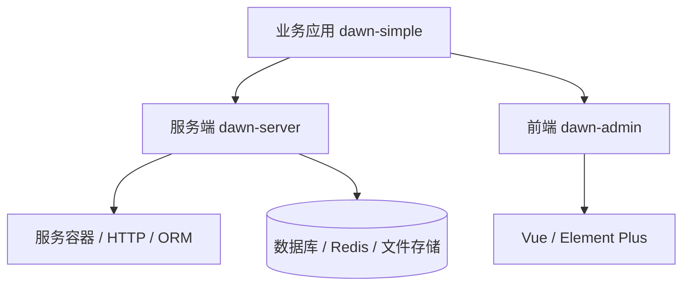

# 架构与目录

Dawn 由服务端框架、前端组件库和应用模板组成。业务代码在 dawn-simple 中开发，通过依赖使用框架能力。

## 应用目录

| 路径 | 职责 |
|---|---|
| `main.go`、`bootstrap/` | 命令入口、服务提供者、路由与迁移装配 |
| `app/admin/menu.go` | 代码菜单、权限、缓存与实时扩展注册 |
| `app/admin/routes.go` | 后台业务路由 |
| `app/admin/controllers/`、`middleware/` | 业务请求处理与中间件 |
| `app/admin/realtime.go` | WebSocket 业务处理器 |
| `app/models/` | 多入口共用的实体，每个实体一个文件 |
| `app/constants/` | 业务缓存定义与队列名称 |
| `app/providers/` | 容器绑定、驱动、监听器与语言注册 |
| `app/cmd/`、`app/schedule/` | 自定义命令与调度 |
| `routes/api.go` | 公开业务 API |
| `database/migrations/`、`database/seeders/` | 结构迁移与基础数据 |
| `config/` | 启动配置，按组件命名空间组织 |
| `admin/src/` | 业务页面、API、顶栏与工作台 |
| `docs/` | 开发文档 |

事件、监听器、异步任务按需放入 `app/events`、`app/listeners`、`app/jobs`。多个入口共用的业务操作可放入 `app/services`；简单逻辑直接写在所属控制器中。

功能菜单与权限在代码中定义，随版本发布，无需手工修改线上菜单表。菜单、页面与接口同步交付，便于代码审查、多环境部署和版本回退；角色授权仍由后台管理。外链等自定义入口可在菜单管理中维护。

## 应用生命周期

`main.go` 将命令交给应用，`bootstrap` 装配服务提供者、路由、迁移和调度。完整入口见 [bootstrap/app.go](https://github.com/dawnim/dawn-simple/blob/main/bootstrap/app.go) 与 [bootstrap/extensions.go](https://github.com/dawnim/dawn-simple/blob/main/bootstrap/extensions.go)。

`Register` 声明懒加载绑定，`Boot` 注册驱动、命令和监听器。数据库、Redis、文件系统由容器创建与释放，HTTP、CLI 和队列共用同一套配置。

每个服务进程拥有自己的 Application 与连接池。共享状态存入数据库或 Redis，退出时先停止服务和 worker，再释放连接。

## 扩展入口

在 `app/admin/menu.go` 的 `Configure` 中追加 `sdk.Options`：

| 选项 | 扩展内容 |
|---|---|
| `Routes`、`PublicRoutes` | 后台业务路由与公开路由 |
| `Menus`、`Permissions` | 页面入口与操作权限 |
| `CacheKeys`、`Settings` | 业务缓存与系统参数 |
| `Realtime` | WebSocket 业务处理器 |
| `WSValidate`、`WSAuthorize` | 扩展身份验证与频道授权 |
| `LinkSystems` | 受控外部系统接入 |

前端通过 `createAdmin` 注册页面、语言和顶栏组件，复用框架布局、主题、请求与权限。

## 数据与运行

接口字段使用 `snake_case`，时间使用 Unix 毫秒。菜单与权限使用稳定 key，记录归属由服务端写入，查询与写入采用一致的数据范围。

数据库结构由迁移管理，初始数据由 Seeder 补齐。`dawn:install` 依次执行迁移、填充和地理库准备；部署时保留与二进制同版的迁移及 Seeder 源码。

`dawn:start all` 分进程运行 HTTP、WS、Horizon 和 cron；`local` 增加前端开发服务器。重载和部署见[服务运行](runtime.md)，业务接入见[后端开发](backend.md)与[前端开发](frontend.md)。
