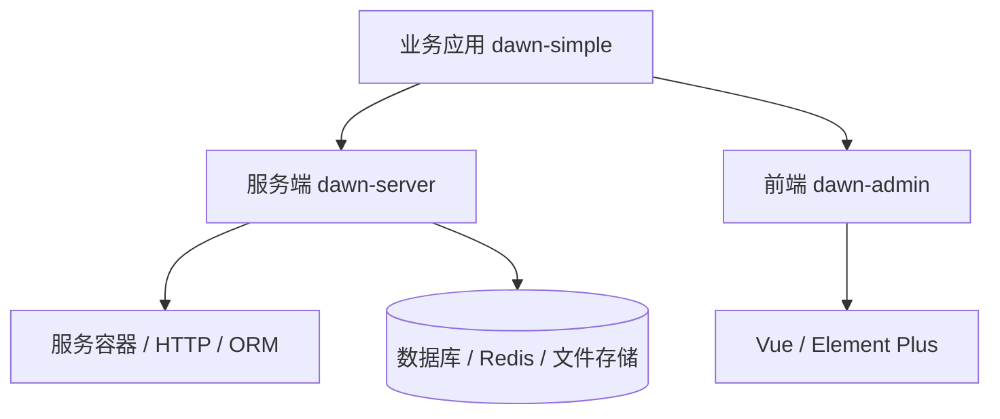

# 架构与目录

Dawn 由服务端框架、前端组件库和应用模板组成。业务代码在 dawn-simple 中开发，通过依赖使用框架能力。



## 项目目录

### dawn-simple

业务应用。Go 端依赖 `dawn-server`，后台前端依赖 `@dawnim/admin`。

```text
dawn-simple/
|-- .github/                  # 持续集成与文档发布
|-- main.go                   # 应用命令入口
|-- bootstrap/                # 装配应用、服务提供者与扩展
|   |-- app.go                # 路由、命令、调度与迁移注册
|   |-- extensions.go         # Dawn 扩展与业务模型注册
|   `-- providers.go          # 应用服务提供者
|-- app/
|   |-- admin/                # 后台业务接入
|   |   |-- controllers/      # 动态与评论等管理接口
|   |   |-- menu.go           # 后台菜单、权限与系统设置
|   |   `-- routes.go         # 后台业务路由
|   |-- cmd/                  # 应用命令
|   |-- constants/            # 业务缓存键与队列名
|   |-- exceptions/           # 应用异常处理
|   |-- models/               # 社区业务模型
|   |-- momentcontent/        # 正文附件引用解析
|   |-- providers/            # 业务服务与语言资源注册
|   |-- schedule/             # 定时任务注册
|   `-- web/                  # 官网、论坛与社区聊天接口
|       `-- assets/           # Go 内嵌的官网前端资源
|-- admin/
|   `-- src/                  # Vue 后台业务前端
|       |-- main.ts           # 后台应用启动
|       |-- api/              # 业务接口客户端
|       |-- assets/           # 应用静态资源
|       |-- components/       # 业务通用组件
|       |-- locales/          # 业务界面翻译
|       `-- views/            # 业务页面
|-- config/                   # 应用及组件配置
|-- database/
|   |-- migrations/           # 业务表结构迁移
|   `-- seeders/              # 业务基础数据
|-- routes/
|   `-- api.go                # 应用公开路由
|-- docs/                     # 中文教程与文档站
|   |-- .vitepress/           # 构建配置、导航与主题
|   |-- en/                   # 英文教程
|   |-- prismgo/              # PrismGo 文档子模块
|   `-- public/               # 文档静态资源
|-- public/                   # HTTP 静态文件与官网文档构建产物
|-- storage/                  # 本地运行时文件
|-- tools/                    # 论坛 Markdown 渲染、打包与测试
|-- go.mod                    # Go 依赖及版本
|-- nginx.conf                # Nginx 部署配置示例
`-- supervisord*.conf         # 服务进程配置示例
```

### dawn-server

基于 PrismGo 的 Go 扩展，提供后台 API、公开身份、文件、聊天和运行管理。

```text
dawn-server/
|-- .github/                  # 持续集成与发布
|-- provider.go               # PrismGo 服务提供者与路由入口
|-- console.go                # Dawn 命令执行与服务生命周期接入
|-- app/
|   |-- admin/                # 后台运行时与公开扩展选项
|   |   |-- controllers/      # 后台管理资源与通用 CRUD
|   |   |-- middleware/       # 认证与权限中间件
|   |   `-- response/         # HTTP 响应约定
|   |-- cmd/                  # 安装、代码生成、结构检查与服务命令
|   |-- models/               # 用户、权限、附件、聊天等扩展模型
|   `-- providers/            # 后台服务、命令与依赖绑定
|-- constants/                # 扩展常量与缓存键
|-- database/
|   |-- migrations/           # 扩展数据库迁移
|   |-- schema/               # 完整结构定义、检查与同步
|   `-- seeders/              # 后台初始数据
|-- realtime/                 # WebSocket 连接与实时消息 Hub
|-- resources/
|   `-- prismgo-lens/         # PrismGo Lens 的后台规范
|-- routes/
|   `-- admin.go              # 后台及扩展路由挂载
|-- support/
|   |-- authsession/          # 身份会话
|   |-- codegen/              # 资源代码生成器与模板
|   |-- customer/             # 客服、聊天及 AI 能力
|   |-- geoip/                # IP 属地解析
|   |-- i18n/                 # 翻译与本地化
|   |-- identity/             # 公开身份与票据
|   |-- settings/             # 运行时设置服务
|   |-- storage/              # 文件存储接入
|   `-- supervisor/           # 独立服务进程及生命周期管理
|-- tests/                    # 扩展集成测试与数据夹具
|-- tools/
|   `-- embedding/            # 嵌入模型工具
`-- go.mod                    # Go 模块与 PrismGo 等依赖
```

### dawn-admin

Vue 后台组件库，发布为 `@dawnim/admin`，并提供可独立挂载的 Markdown 编辑器。

```text
dawn-admin/
|-- .github/                  # 持续集成与发布
|-- scripts/                  # 独立编辑器与聊天挂件的打包脚本
|-- src/
|   |-- index.ts              # createAdmin 等公共入口
|   |-- api/                  # 框架后台接口客户端
|   |-- assets/               # 图片、SVG 与公共样式
|   |-- components/           # 布局、表格、表单及 Dawn 组件
|   |-- composables/          # 可复用的组合式逻辑
|   |-- config/               # 后台默认配置
|   |-- dawn/                 # Dawn 的公共前端功能
|   |   |-- CrudPage.vue      # 通用资源管理页
|   |   |-- Upload.vue        # 通用上传组件
|   |   |-- crud/             # CRUD 表单、查询与列表逻辑
|   |   |-- editor.ts         # 独立的 Markdown 编辑器
|   |   |-- editor-bundle.ts  # 独立编辑器打包入口
|   |   |-- markdown.ts       # 默认渲染与页面内容增强
|   |   |-- chat.ts           # 后台聊天接入
|   |   |-- realtime.ts       # 实时连接与事件处理
|   |   `-- lang/             # 公共组件文案
|   |-- directives/           # Vue 指令
|   |-- enums/                # 公共枚举
|   |-- hooks/                # 表格与界面交互 Hooks
|   |-- locales/              # 后台界面语言包
|   |-- plugins/              # 第三方前端插件配置
|   |-- router/               # 路由、导航与访问控制
|   |-- store/                # Pinia 状态
|   |-- types/                # 前端源码类型
|   |-- utils/                # 请求与工具函数
|   `-- views/                # 内置后台页面
|-- tests/                    # 组件与运行时测试
|-- types/                    # 随 npm 包发布的类型声明
|-- package.json              # npm 依赖与公开子路径
`-- vite.config.ts            # 开发与打包配置
```

## 应用生命周期

`main.go` 将命令交给应用，`bootstrap` 装配服务提供者、路由、迁移和调度。完整入口见 [bootstrap/app.go](https://github.com/dawnim/dawn-simple/blob/main/bootstrap/app.go) 与 [bootstrap/extensions.go](https://github.com/dawnim/dawn-simple/blob/main/bootstrap/extensions.go)。

`Register` 声明懒加载绑定，`Boot` 注册驱动、命令和监听器。数据库、Redis、文件系统由容器创建与释放，HTTP、CLI 和队列共用同一套配置。

每个服务进程拥有自己的 Application 与连接池。共享状态存入数据库或 Redis，退出时先停止服务和 worker，再释放连接。

## 扩展入口

在 `app/admin/menu.go` 的 `Configure` 中追加 `sdk.Options`：

| 选项 | 扩展内容 |
|---|---|
| `Routes`、`PublicRoutes` | 后台业务路由与公开路由 |
| `Menus`、`Permissions` | 页面入口与操作权限 |
| `CacheKeys`、`Settings` | 业务缓存与系统参数 |
| `Realtime` | WebSocket 业务处理器 |
| `WSValidate`、`WSAuthorize` | 扩展身份验证与频道授权 |
| `LinkSystems` | 受控外部系统接入 |

前端通过 `createAdmin` 注册页面、语言和顶栏组件，复用框架布局、主题、请求与权限。

## 数据与运行

接口字段使用 `snake_case`，时间使用 Unix 毫秒。菜单与权限使用稳定 key，记录归属由服务端写入，查询与写入采用一致的数据范围。

数据库结构由迁移管理，初始数据由 Seeder 补齐。`dawn:install` 依次执行迁移、填充和地理库准备；部署时保留与二进制同版的迁移及 Seeder 源码。

`dawn:start all` 分进程运行 HTTP、WS、Horizon 和 cron；`local` 增加前端开发服务器。重载和部署见[服务运行](runtime.md)，业务接入见[后端开发](backend.md)与[前端开发](frontend.md)。
