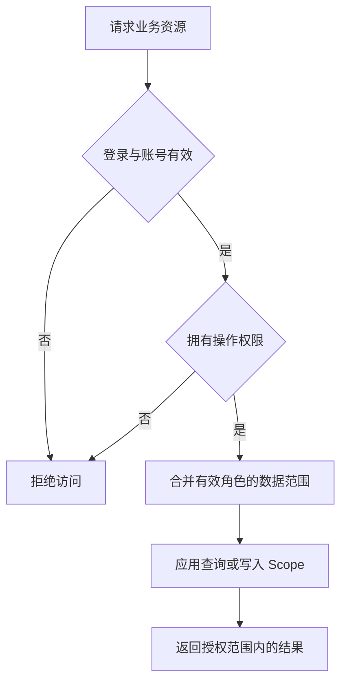

# 权限与数据范围

授权由三部分组成：操作权限决定能做什么，管理级别决定能管理哪些账号与角色，数据范围决定能访问哪些记录。

## 登录与会话

管理员登录后使用 Bearer Token 请求接口，前端公共 `request` 负责凭证携带与刷新。访问与刷新有效期默认均为 30 天，可通过 `DAWN_ACCESS_TTL`、`DAWN_REFRESH_TTL` 配置。

接口校验会话和账号状态；WebSocket 使用 HTTP 签发的一次性票据认证，并持续检查账号有效性。多语言提示按请求的 `Accept-Language` 返回。

## 操作权限

| 命名空间 | 用途 |
|---|---|
| `dawn.*` | 框架内置功能 |
| `app.*` | 业务代码定义的菜单与权限 |
| `custom.*` | 后台创建的自定义菜单与操作权限 |

key 保存后保持稳定。代码菜单负责页面定义，数据库保存角色授权和自定义菜单。前端 `v-permission` 控制按钮显示，接口独立校验权限。

自定义菜单支持目录、页面、按钮和外链。页面的组件路径与前端 `pages` 注册路径一致；按钮挂在菜单下参与授权。外链支持新窗口和 iframe，受控系统可通过一次性票据交换身份，再校验实时授权。

## 数据范围

在角色管理中选择范围，将角色分配给管理员；部门范围还需设置账号所属部门。

| 范围 | 值 | 可访问记录 |
|---|---|---|
| 本人 | `self` | 当前管理员创建的记录 |
| 本部门 | `department` | 本人记录及本部门、全部下级部门的记录 |
| 指定部门 | `departments` | 本人记录及指定部门、全部下级部门的记录 |
| 全部 | `all` | 当前操作权限内的全部记录 |

多个有效角色的范围取并集，任一角色为“全部”即放开范围；停用角色不参与。本部门范围下，未分配部门的账号按本人归属读取。修改角色后，授权从下一次请求生效。

超级管理员由 `admin_users.super` 标识，接口字段为 `is_super`，拥有后台操作与数据范围权限。私聊等成员资源仍按成员关系授权。

## 业务表接入

| 字段 | 内容 |
|---|---|
| `created_by` | 创建管理员 ID，类型与管理员主键一致 |
| `department_id` | 数据归属部门 ID，类型与部门主键一致，未分配为 0 |

字段建议非空并建立索引。内置 `models.Base` 提供主键、时间和软删除，归属字段由业务模型声明。

代码生成器根据表结构接入：

| 业务表字段 | 生成行为 |
|---|---|
| `created_by` | 支持本人范围；部门类范围按本人处理，“全部”访问全部记录 |
| `created_by`、`department_id` | 支持四种范围 |
| 仅 `department_id` 或均无 | 按普通资源生成，数据范围由业务补充 |

手写资源通过 `Resource.Scope` 过滤，通过 `Resource.Prepare` 写入归属，完整示例见[后端开发](backend.md#手写-crud)。列表、计数、详情、写入、删除、导出和下载使用相同范围。

通用 CRUD 由服务端管理上述归属字段，新增和导入时写入，更新时保留。管理员更换部门后，已有记录的归属保持原值。自定义控制器使用 `middleware.Actor(c).Scope(...)`；关联查询传入带表名的列名，如 `records.created_by`。

## 管理级别

角色 `level` 越大，管理级别越高；同一管理员取有效角色中的最高级别。普通管理员可管理、分配严格低于自身级别的角色。

管理员与角色目录按查看权限展示。账号写入同时受操作权限、数据范围和管理级别约束；当前账号、超级管理员、同级以上和范围外账号显示为只读。分配已有下级角色使用角色分配规则。

附件管理为共享库，普通管理员的日志仅限本人，部门、岗位等基础配置按操作权限管理；业务记录按资源声明的 Scope 过滤。

## 授权更新与缓存

资料、权限、菜单分别按用户缓存 4 小时、2 小时和 7 天。内置账号、角色、岗位和菜单变更在提交后失效相关缓存；手动清理用户缓存、设置工作台时，通过 WebSocket 通知在线页面更新。

业务代码直接修改授权数据后，在事务提交后调用 `a.ClearUserCaches(ctx, userID)`；省略 ID 时清理全部用户。该操作更新授权版本，防止并发请求回填旧缓存，登录会话保持有效。

| 用户操作 | 接口 | 权限 |
|---|---|---|
| 设置工作台 | `PUT /admin/users/{id}/dashboard` | `dawn.users.dashboard` |
| 清理缓存 | `DELETE /admin/users/{id}/cache` | `dawn.users.cache` |
| 重置密码 | `PUT /admin/users/{id}/password` | `dawn.users.password` |
| 角色授权 | `PUT /admin/roles/{id}/permissions` | `dawn.roles.permissions` |
