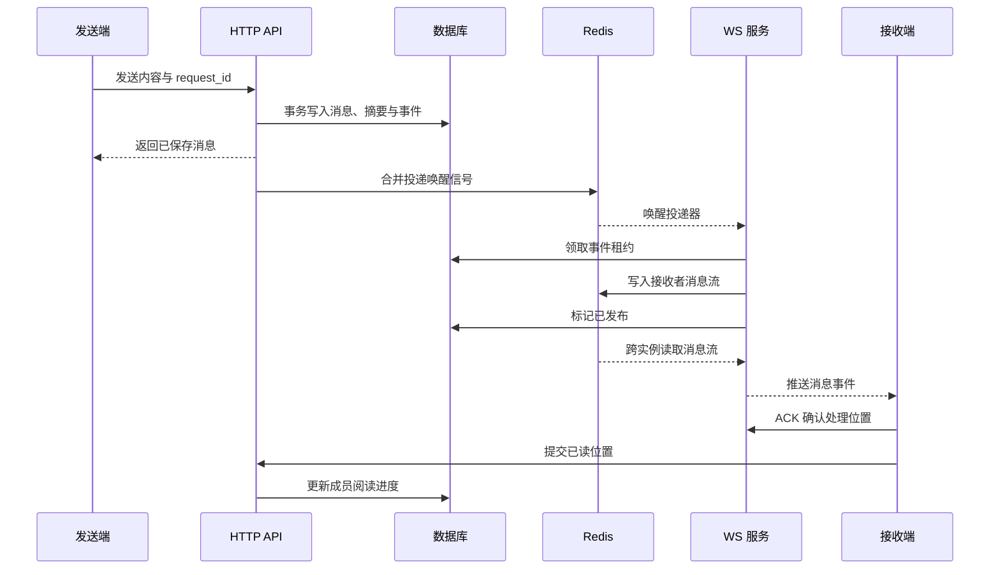

# 聊天与实时通信

HTTP 负责数据读写，WebSocket 负责实时同步。管理员聊天与业务消息共用连接、身份认证和应用资源。

管理员聊天由扩展完整提供：dawn-server 负责表结构、接口与消息投递，dawn-admin 负责聊天界面与实时客户端。应用注册扩展、执行统一安装后即可使用。

## 管理员聊天

登录后台即可聊天。顶栏图标打开会话列表，搜索联系人或点击用户名旁的图标发起单聊。聊天窗口支持返回列表、历史消息、未读提醒、已读同步、发送重试与亮暗主题。

聊天按会话成员授权，联系人只提供 ID、用户名、姓名与头像。账号有效性随接口请求与连接心跳检查。

## 扩展方向

当前提供管理员之间的文本单聊。用户聊天、群聊与智能客服属于后续扩展：

| 场景 | 扩展内容 |
|---|---|
| 用户间聊天 | 接入用户身份域、联系人规则与用户端界面 |
| 群聊 | 增加群资料、成员角色、邀请与退群规则 |
| 智能客服 | 接入 AI 回复、人工接管、客服分配与会话状态 |

身份域、会话成员、消息类型和状态为这些场景提供基础。客服接入时可沿用同一会话与消息记录，按状态决定由 AI 或人工回复，保留完整的转接历史；具体业务接口与界面随场景实现。

## 聊天数据

| 表 | 职责 |
|---|---|
| `chat_conversations` | 会话身份、最后消息与排序 |
| `chat_members` | 成员身份与已读位置 |
| `chat_messages` | 发送者、内容、状态与请求编号 |
| `chat_events` | 待发布事件、租约与重试记录 |

身份使用 `realm + subject`，与 WS 的 `Principal` 一致。单聊标识由双方 ID 排序生成，发送重试复用 UUID `request_id`，已读位置只向前推进。同一请求编号对应不同内容或会话时返回 `409`。

## 消息投递

消息、会话摘要和推送事件在同一事务中提交。提交后通过 Redis 唤醒投递器，由数据库租约协调多实例发布。



投递器每批处理 100 条，空闲时每 30 秒执行一次补偿扫描。采用至少一次投递，客户端按 `event_id` 或消息 ID 合并。`published_at` 表示事件已写入消息流，ACK 表示设备处理进度，已读位置表示用户阅读进度。

| 事件 | 数据 |
|---|---|
| `chat.message.created` | 消息表示 |
| `chat.read.updated` | 会话、成员身份与已读消息 ID |

聊天事件外层 `data` 为 `{event_id,data}`。客户端在 `ready` 或 `resync_required` 时通过 HTTP 同步，数据库提供完整历史。会话刷新与已读提交合并处理，减少重复请求。

## HTTP 接口

| 方法与路径 | 用途 |
|---|---|
| `GET /admin/chat-contacts` | 联系人分页，`search` 搜索用户名和姓名 |
| `POST /admin/chat-conversations` | 提交 `user_id` 获取或创建单聊 |
| `GET /admin/chat-conversations` | 会话分页，`meta.unread_total` 返回未读总数 |
| `GET /admin/chat-conversations/{id}/messages` | 历史消息，使用 `page_size`、`before_id` |
| `GET /admin/chat-conversations/{id}/messages/{message_id}` | 单条消息 |
| `POST /admin/chat-conversations/{id}/messages` | 提交 `request_id`、`content` 发送文本 |
| `PUT /admin/chat-conversations/{id}/read-position` | 提交 `message_id` 更新已读位置 |

文本上限 4000 字符，每位管理员每分钟最多发送 60 条。历史分页返回 `meta.has_more` 和下一页的 `meta.before_id`。

## 业务 WebSocket

在 `app/admin/realtime.go` 注册处理器，通过 `Configure` 的 `o.Realtime = RegisterRealtime` 装配。处理器复用 `a.DB`、`a.Redis`、`a.Key` 与管理员授权。

dawn-simple 的 [实时示例](https://github.com/dawnim/dawn-simple/blob/main/app/admin/realtime.go) 注册 `app.greeting`，校验 `app.realtime_example.view`，读取当前管理员的五分钟问候缓存。Key 在 `app/constants/key.go` 定义，并注册到缓存管理。

| 扩展入口 | 用途 |
|---|---|
| `Hub.Handle` | 注册业务请求，按 `request_id` 返回 `result/error` |
| `Hub.Publish`、`Hub.PublishChannel` | 向身份或频道发布消息 |
| `Hub.Ticket`、`Options.WSValidate` | 签发连接票据、扩展身份验证 |
| `Options.WSAuthorize`、`Hub.Authorize` | 频道订阅授权 |
| `Hub.AuthorizeEvent` | 事件投递授权 |
| `Hub.Connected`、`Hub.Disconnected` | 单个物理连接的生命周期 |

业务使用独立事件名称，框架保留认证、订阅、确认、心跳及响应等控制消息。扩展授权与生命周期回调时，按业务命名空间组合既有规则。处理器继承连接 context，耗时任务交给队列，共享状态存入数据库或 Redis。

多设备分别触发生命周期回调。身份收件流按 `realm + subject` 寻址，恢复凭证绑定登录会话；恢复范围由 Redis 保留时间与条数决定。

## 前端调用

```ts
import { onBeforeUnmount } from 'vue'
import { realtime, openChat } from '@dawnim/admin'

const stop = realtime.on('order.updated', async ({ data }) => {
  // 按业务数据更新页面
})
onBeforeUnmount(stop)

const result = await realtime.request<{ greeting: string }>('app.greeting')
openChat()
```

`openChat()` 打开列表；传入 `{id, username, realname?, avatar?}` 打开指定管理员单聊。`realtime.status.value` 提供 `closed`、`connecting`、`ready` 状态。请求支持超时与断连反馈，`subscribe/unsubscribe` 管理授权频道并在重连后恢复订阅，事件处理完成后再确认消息。
