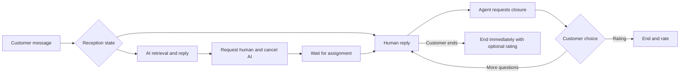

# AI support and extensions

Each support application configures its own brand, agents, models, knowledge, website entries, and Telegram bot. Each app has an independent AI identity. Admin private chat remains membership-authorized; support permissions never expose someone else's private conversations.

## Configure and use

Support applications, knowledge, and visitors use standard system lists: query/reset filters, refresh, density, fullscreen, column settings, and batch deletion. Create/edit forms use standard dialogs. Knowledge entry retains a source/result two-column editor.

1. Create a support app under Customer service with a name, brand avatar, agents, and capacity
2. Select the model protocol, name, endpoint, and key, then enable AI reception
3. Add knowledge or import text, Markdown, and public pages; automatic imports require review
4. Review and publish entries; choose reference-based answers or exact approved text
5. Configure embeddings, rebuild the index, then copy the app's chat link or widget script

Markdown and web pages are split by sections and paragraphs while preserving code fences. Titles use document name–section name, with numbers for multiple chunks in a section. Generated tables of contents are excluded. If content or chunking rules change during reimport, old published chunks are atomically disabled and new chunks require review. Unchanged content and rules preserve publication state. Deleting a source immediately excludes its chunks. Knowledge managers receive only app IDs/names within their data scope and need no app-configuration permission.

Application dialogs use the standard form layout with aligned short fields in two columns. The body scrolls without a visible scrollbar. Website entries are collapsible; tool/Skill lists open JSON settings and installation in separate dialogs. Creation and editing share the same layout; actions requiring an app ID are available after saving.

Administrators with application update permission and the appropriate data scope can reveal or copy identity signing keys and Telegram tokens on demand. Saved answer-model API keys cannot be revealed. A submitted new key is checked against the proposed model configuration before saving. Failed checks preserve the previous configuration, key, and revision; an empty input keeps the old key. Other edits do not recheck the old key. Validation may incur a small model API charge.

Answer and embedding services have separate encrypted keys. Visitor APIs never expose model, tool, or secret configuration. Grant app-configuration permission to trusted administrators, since it controls model and connector addresses.

The example website at HTTP `/` provides registration, login, and support. The admin frontend retains its own server/domain. Installation creates the `dawn` demo app and publishes Dawn and PrismGo Chinese docs from the deployment directory without overwriting existing app settings. When deploying only a binary, also deploy `docs` or import materials in admin. AI is initially disabled until its endpoint and key are configured. Human support works independently.

Default local addresses are `http://localhost:5123/` for the website and `http://localhost:5173/` for admin. Website assets live in `app/web/assets`; `app/web/web.go` registers and embeds them in the Go binary. Customize them directly. Theme icons cycle system, light, and dark and update the support widget. Website and docs language changes also update visitor UI; see [Shared website language](frontend.md#shared-website-language).

The website's `linkRules` maps official GitHub Pages documentation links in AI text and citations to same-site `/docs/`, retaining query strings and anchors. Knowledge retains its original sources. Telegram and other host websites are unaffected. A persistent website shell keeps support open while reading citations. See [Floating widget](chat.md#floating-widget).

Visitor chat, agent chat, and admin private chat support Markdown headings, lists, quotes, links, tables, and code fences. Streaming replies parse the visible text continuously. Raw HTML is displayed as text; Markdown images remain text and do not load remote resources. Emoji align inline. Shared rendering lives in dawn-admin's `src/dawn/markdown.ts` and `markdown.css`. After changing it, run `pnpm build:chat-assets ../dawn-server/support/customer/web` in dawn-admin, then build both applications.

## Model protocols and reasoning effort

| `config.model_protocol` | Protocol | Reasoning parameter |
|---|---|---|
| `responses` (default) | OpenAI Responses | `reasoning.effort` |
| `chat_completions` | OpenAI Chat Completions | `reasoning_effort` |
| `anthropic` | Anthropic Messages | `thinking` and `output_config.effort` |

All protocols share retrieval, tool authorization, Agent Skills, streaming, and agent drafts. Tool-call context is preserved, including Anthropic thinking signatures. Reasoning is not displayed as a customer reply.

Set `base_url` to the API base, such as `https://api.example.com/v1/`. Domain-only URLs gain `/v1`; custom paths remain unchanged. The Anthropic SDK appends `v1/messages`, and its adapter avoids duplicating `v1`. Put secrets only in the key field.

New applications default to `low`. Reasoning effort is free-form with common OpenAI/Anthropic values available for quick selection. Custom provider values are accepted. An empty `reasoning_effort` uses the model default. OpenAI options are `none/minimal/low/medium/high/xhigh/max`; actual support depends on the model. For Anthropic, empty leaves thinking unconfigured, `none` disables it, and other levels use adaptive thinking. Older models without adaptive support retain defaults. Rejected parameters never silently trigger another effort level or protocol.

With `max_output_tokens=0`, Responses and Chat Completions add no extra output limit; Anthropic uses 8192. Positive values set the protocol's output limit. Reasoning can consume output tokens, so small limits may produce empty or truncated replies. Run records retain redacted upstream errors, HTTP status, and request IDs; visitors receive generic messages.

After saving, use Test saved model configuration to check real streaming and a tool-call round trip. Alternatively, run from dawn-simple:

```sh
go run . dawn:model-check 1
go run . dawn:model-check 1 --queue
```

`--queue` uses the actual Horizon queue and records a diagnostic run. Success includes `tool_tested: true`. Checks create no chat and do not change app settings.

Visitors can retry failed or interrupted replies only for the current question under AI reception, without duplicating their message. Old replies cannot be retried after human handoff or a new question. Ask a new question after switching protocol; running tool context is not replayed across protocols.

Empty reply bubbles show states such as Replying or Reply stopped at a normal message height. Failed/interrupted replies show a red retry icon to the bubble's right.

## Retrieval and embedding changes

Knowledge is app-isolated. Entries retain applicability, sources, versions, and helpers. Draft/disabled entries are excluded from retrieval. Knowledge management shows all statuses by default and can filter published, pending, or disabled entries. Search checks title, keywords, and body. For exact-text entries, the model selects an entry and the approved answer is sent unchanged. Reference entries support composed answers and citations. Unclear applicability should lead to clarification or human handoff.

Keyword retrieval matches titles, keywords, and bodies using Chinese bigrams while retaining English API identifiers. Ranking considers term frequency, distinctiveness, and content length. Per-source limits preserve diversity; related sections from principal sources supplement candidates so usage details are not missed. Active semantic indexes merge vector and keyword candidates. Models can use `search_knowledge(query)` to reformulate follow-ups or try other terms, then `knowledge(id)` to select evidence and record citations. No initial candidates does not prove documentation is absent. App prompts describe the product; earlier AI answers are not verified knowledge.

Demo documentation titles distinguish product and section. After updating local docs, run `go run . app:support-docs` in dawn-simple to synchronize and publish the official demo knowledge. It preserves source IDs and disables old chunks, without changing model settings, chats, or other apps. Other apps manage their own source imports and reviews.

Configured model/dimensions describe the next index build. Queries use the completed active index's specifications, never new-model queries against old vectors. A build becomes active only after completion and a knowledge-version check. Failure preserves the old index. Old indexes are cleaned up later. Deleted or changed knowledge versions are excluded from old-index matches; keyword retrieval remains available before rebuilding.

Setting an embedding model does not mean an index is ready. Without an active index, retrieval is keyword-only. Start the embedding service and complete Rebuild knowledge index to enable semantic retrieval.

| Storage | Vector behavior | Usage |
|---|---|---|
| Portable | BLOB vectors with Go similarity plus keywords | SQLite, MySQL, MariaDB, and PostgreSQL; suitable for smaller knowledge sets |
| MariaDB native | `VECTOR(N)` and vector indexes | A MariaDB version supporting vectors, with the `mariadb` index driver |
| MySQL 9.7 | `VECTOR` storage; distance/index functions vary by product | Use portable storage for ordinary MySQL; HeatWave/MySQL AI capabilities are not Community defaults |
| External knowledge | Registered retriever | Connect an existing knowledge service or vector database |

See official [MariaDB vector documentation](https://mariadb.com/docs/server/reference/sql-structure/vectors) and [MySQL vector function documentation](https://dev.mysql.com/doc/refman/9.7/en/vector-functions.html).

```go
options.Customer = func(m *customer.Manager) {
    m.RegisterRetriever("external", func(ctx context.Context, appID uint, query string) ([]customer.Evidence, error) {
        // Restrict results to appID and return published knowledge with citations.
        return knowledgeClient.Search(ctx, appID, query)
    })
}
```

Set `config.index_driver` to the registered name. Custom retrievers own their index builds; the built-in rebuild operation handles portable and MariaDB-native storage.

## Local embedding service

The extension embeds its Python scripts and dependency list in the Go binary. Run from any consuming project, without locating a module cache or sibling checkout:

```sh
go run . dawn:embedding install
go run . dawn:start embedding
```

Installation publishes scripts to `storage/support/embedding`, creates `.venv` there using `EMBEDDING_PYTHON` (default `python3`, Python 3.10+), and installs dependencies. Re-running it updates scripts and dependencies without removing the environment or model cache. Normal service startup never installs dependencies.

`dawn:start embedding` uses the existing manager and supports `status`, `stop`, and `restart`. Set `EMBEDDING_ENABLED=true` to include it in `all` and `local`; it remains optional by default. A Go child owns the Python process. The manager shows a waiting state while weights download or load and marks it ready after `/health` succeeds. Stopping the manager also stops the Python process. Dependency setup is explicit; weights download on the first model startup.

Configure these fields under `dawn.embedding` in your application's configuration, with `.env` bindings as shown in the example project:

| Variable | Default | Meaning |
|---|---|---|
| `EMBEDDING_ENABLED` | `false` | Include in all/local |
| `EMBEDDING_DIRECTORY` | `storage/support/embedding` | Tools, virtual environment, and model cache |
| `EMBEDDING_PYTHON` | `python3` | Interpreter used to create the virtual environment |
| `EMBEDDING_HOST` / `EMBEDDING_PORT` | `127.0.0.1` / `8852` | Listener |
| `EMBEDDING_MODEL` | `Qwen/Qwen3-Embedding-0.6B` | Model loaded by the process |
| `EMBEDDING_THREADS` | `4` | CPU threads |
| `EMBEDDING_MAX_LENGTH` | `2048` | Input context limit |
| `EMBEDDING_DEVICE` | `cpu` | Sentence Transformers device |

Common names are `Qwen/Qwen3-Embedding-0.6B`, `Qwen/Qwen3-Embedding-4B`, `Qwen/Qwen3-Embedding-8B`, `BAAI/bge-m3`, and `intfloat/multilingual-e5-small`. Click a name in the form to copy it. One model is loaded per process; the form name must match `EMBEDDING_MODEL`. Editing the form does not download or switch weights. Restart the embedding service after changing its configuration, then rebuild the app index.

Use `http://127.0.0.1:8852/v1/` as the embedding API base. Qwen3-Embedding-0.6B supports 32–1024 output dimensions from the same weights; 1024 is the starting recommendation. Truncation and normalization do not proportionally reduce model memory. See the [model documentation](https://huggingface.co/Qwen/Qwen3-Embedding-0.6B). Other models have their own dimension and truncation constraints.

A 4-core, 8 GB machine is a starting point for low-concurrency CPU use, not a guarantee of latency or memory headroom. Keep the service on an internal interface. Binary-only Go deployments work because scripts are embedded; the host still needs Python for installation. Remote compatible embedding services remain supported. Active index profiles retain their model, dimensions, endpoint, and encrypted credential until the replacement index is built.

## Tools and Agent Skills

A standard `SKILL.md` describes a workflow. Admin supports single files or ZIPs containing `SKILL.md`, references, and scripts. Scripts do not execute automatically. The model loads instructions and reads references as needed; actual operations use registered Go tools, read-only datasets, HTTP, or MCP connectors.

```markdown
---
name: account-profile
description: Look up the current signed-in user's profile on this website
allowed-tools: account_profile
---
Confirm that the current user is signed in, then call account_profile. Never accept a caller-selected account.
```

Tool configuration declares JSON Schema and allowed capabilities. The server supplies user, app, conversation, and verification context. Model-supplied `user_id` cannot override them.

```go
options.Customer = func(m *customer.Manager) {
    m.RegisterTool("account_profile", func(ctx context.Context, actor customer.ToolActor, args map[string]any) (any, error) {
        if !actor.Verified || actor.UserType != models.UserMember || actor.Public || actor.IdentityProvider != "" {
            return nil, customer.ErrForbidden
        }
        var user models.User
        err := m.DB.WithContext(ctx).
            Select("id", "unique_id", "nickname", "locale").
            First(&user, actor.UserID).Error
        return user, err
    })
}
```

`dawn-simple` registers this tool for the official demo app so signed-in website members can query their own local profile. Verified external-product users do not gain local account lookup rights.

Developers must register read-only datasets first. Admin settings cannot choose arbitrary tables or columns.

```go
m.RegisterQuery("my_orders", customer.Query{
    Table: "orders", Columns: []string{"id", "order_number", "status"},
    Filters: []string{"status"}, UserColumn: "user_id", MaxRows: 20,
})
```

App tools use `driver: "sql"` and the registered name. Queries always add the trusted user constraint; selected/filter columns come from registration. External-identity datasets also need matching `IdentityProvider` and `AppColumn`, preventing external IDs from accessing local accounts.

External products expose data through HTTP or MCP; their database need not run on Dawn's server. HTTP connectors receive `{arguments, actor, idempotency_key}`. The remote server validates configured header credentials, then enforces permissions and scopes using `actor`. MCP preserves standard tool arguments and puts trusted context in `_meta["dawn/actor"]`; metadata is not a substitute for remote authentication.

Tools with `confirmation: true` create pending actions and execute only after the visitor or assigned agent confirms. Confirmation binds the tool definition, arguments, and conversation version. HTTP and Go tools receive stable idempotency identifiers; write handlers must use them to make retries safe.

## Human service and long tasks

Human requests move AI conversations into the queue. Online agents with capacity may receive assignments or claim manually. Reception state is shared by admin windows; heartbeats renew leases without overwriting manual choices in other windows. Agents not accepting new consultations can still manage assignments; expired agent connections requeue unfinished rounds. Handoff cancels old AI work and stores an internal suggestion only when a reply was being generated. Existing human drafts are never overwritten automatically.

Each human round has one `support_sessions` row containing agent, status, version, times, rating, and comment. Messages remain in the long-lived conversation. An agent's closure request retains human mode, owner, and occupied capacity. An inline card offers Good / Neutral / Poor / More questions. Rating also ends the round and stores feedback; comments are optional, with no modal. Visitors may immediately end a queue or active round through End conversation, then optionally rate. Ratings are 1 poor, 2 neutral, and 3 good.

More questions or a public message from either side cancels a closure request. Transfers and offline reassignment invalidate old cards. Ratings target `session_id`, so new consultations do not affect older rounds; identical resubmissions succeed. Queued visitors can return to AI; agents cannot unilaterally end service. AI assistance streams as an internal suggestion and fills the composer only after completion when it is empty and the agent is viewing it. It never sends automatically or overwrites typed text. Failures show their reason and allow regeneration.



Answer jobs default to 3 minutes. Still-valid runs interrupted by worker reload are requeued; work cancelled by handoff or a newer message is not resumed. Imports, indexing, and Agent runs can have 6-hour overall deadlines. Worker timeout defaults to 21600 seconds and Redis retry retention to 21660 seconds. Run leases renew every minute to prevent duplicate long-task execution. Example Horizon retains only `supervisor` and `multiples` groups.

SQL stores runs, confirmations, messages, and pending delivery events. Redis stores tickets, presence, typing previews, and streaming snapshots. Clients use execution attempts and fragment sequences for streams and recover persisted snapshots/history on reconnect.

## Telegram and public extension points

The WS process checks enabled applications at startup and every 5 seconds. Configuration revision changes cancel and drain the previous bot task before launching a replacement; disabling or deleting an app stops its task. Redis leases prevent duplicate polling across WS instances. No service restart is needed.

Group IDs accept manually entered negative integers or discovered candidates. Membership events and group messages record group titles and IDs in an app/bot-isolated Redis cache for 30 days. Discovery never grants access: select and save a group to allow service. Telegram cannot enumerate every group a bot has joined; manually enter IDs when no event has been received.

Each support app can configure one bot, and a bot's numeric ID cannot belong to multiple apps. The existing WS process manages bots, each with a goroutine and Redis lease, without a process per bot. SDK updates are persisted to SQL run records before acknowledging the upstream offset; failed sends retry. Telegram has no sending idempotency key, so a successful send with a lost response may still produce duplicates.

Group bots respond when mentioned or replied to by default, with an option for ordinary messages. Only allowed groups are accepted. Each customer has separate group/topic context. Personal business tools are disabled in groups by default. Human requests can mention entry-linked helpers who have Telegram bindings and are still group members.

Admin binding generates a single-use code. The administrator sends `/bind code` privately to the bot, then confirms the numeric ID and username in admin. Usernames are mutable metadata; numeric IDs establish identity. Telegram interactions may create regular users; confirmation links the admin through `AdminUser.UserID` without granting support permissions.

| API | Purpose |
|---|---|
| `customer.ManagerFrom(resolver)` | Resolve the shared container instance |
| `Manager.RegisterTool` | Register Go business tools |
| `Manager.RegisterQuery` | Register scoped read-only datasets |
| `Manager.RegisterRetriever` | Integrate existing knowledge systems |
| `customer.ParseSkill` | Read standard Skill files |
| `Manager.TelegramUser` | Find/register users from trusted Telegram data |
| `Manager.TelegramBot` | Reuse app-configured SDK clients |
| `Manager.RegisterTelegramHandler` | Extend bot commands and events |

Register capabilities through `admin.Options.Customer`; do not create separate SQL/Redis connections. Embed public models to extend them. Override admin pages through `createAdmin({pages})` and extend customer details through `support.customerInfo`.

## Enter and maintain knowledge

Choose Add knowledge in Customer service. Enter complete text or a public URL on the left and ask AI to organize it. Edit the resulting title and Markdown on the right, with a preview toggle. Switch generated entries through the selector without losing edits, or remove unwanted entries. Saving submits every entry in one transaction; if any entry fails, none are saved. More settings contains keywords, applicability, reply mode, and helpers.

Editing loads the latest details and submits their version to prevent overwriting another administrator's changes. AI can reorganize an existing entry; multiple generated topics are merged into its Markdown body, preserving its identity, helpers, and publication status. Closing the dialog cancels an unfinished AI generation request.

Administrator-reviewed and saved content is published by default. Automatic source imports still require review before publication. Sources retain original input and processing status; entries retain retrievable content. One source may produce many entries.

Sources support text, Markdown, and public URLs. Save retains the original input; Save and process then queues it. After processing fails, edit the input and retry. If saving succeeds but queuing fails, retry reuses the saved source instead of creating a duplicate. Queued or processing sources cannot be edited or processed again. After completion, open the generated entries for that source. Visible source and run lists refresh automatically while tasks are pending.

Retrieval tests search published knowledge in the selected app and show scores, rendered Markdown, applicability, and sources. Results have a fixed-height scrolling area with hidden scrollbars. Switching apps, starting another query, or closing the dialog cancels the previous request. Execution records can be filtered by app, task type, and status to inspect processing errors.

Helper search is paginated and lists enabled regular users with a Telegram ID greater than zero. Editing restores selected helpers; searching preserves selections. The entry stores user IDs. Group notifications recheck binding and membership. Administrators participate through linked regular users; no admin promotion is necessary.

The server fetches and extracts public HTTP/HTTPS pages only; local/private addresses are blocked. Failed fetches do not publish empty knowledge. Entries preserve their source URL.

## Skill directories and installation

Relative to the configured storage directory:

```text
storage/support/skills/<name>/SKILL.md
storage/support/apps/<public_key>/skills/<name>/SKILL.md
```

Directories may contain references and other resources. Global Skills require explicit app enablement; app Skills belong only to their app. SQL stores names, descriptions, scope, and tool declarations; directories contain instructions and resources. Use shared persistent storage across instances and back up both SQL and files.

Under app extension capabilities, administrators can upload `SKILL.md`/ZIP or describe a need to AI to generate an installation preview. Continue chatting to revise it, edit the result, then confirm installation. Reference URLs are supported. This requires app-update permission and app data scope; global installation additionally requires a super administrator. Visitors have no installation API.

Existing same-name directories are never overwritten. Deployment administrators maintain updates directly in the directory. Save app settings after selecting a global Skill. Skills provide instructions and resources; scripts do not run automatically. Actual operations use registered, authorized tools.

## Visitor disconnection and capacity release

In app branding/reception settings, `offline_timeout_minutes` defaults to 10, with 0 disabling it. `closing_offline_minutes` defaults to 3, with 0 inheriting the former. Timers start only for sustained website disconnection. Connected but idle visitors do not end service. Website presence rules do not apply to Telegram.

All tabs and devices for the same app/user share presence. Any valid connection preserves the round. Collapsing the widget or reading website docs is not disconnection. Reconnecting cancels the timer: before expiry the same round resumes; after expiry history remains and a new message starts another round. Waiting visitors have their queue entry cancelled; active rounds end and release capacity.

Agent-requested closure still needs customer confirmation. Offline expiry has a distinct reason and never implies consent or an automatic rating. Customers can rate a completed human round; cancelled queues cannot be rated. Admin shows presence, last online time, and remaining retention time.

The server checks WS connection leases shared through Redis. The existing loop checks roughly every 30 seconds, so closure can occur slightly after the configured interval. Redis failures pause closure; after Redis/scheduler interruptions, timing restarts. `started_at` distinguishes never-served queues from served rounds that were requeued. Records include `offline_since`, `last_online_at`, `closing_requested_at`, and `close_reason` in the initial schema migration.

## Calling the model from business code

Reuse a support application's model configuration for text generation. `appID` is its database ID; `instructions` and `input` contain the system instruction and user input.

```go
text, err := a.Customer.GenerateText(ctx, appID, "Answer concisely", "Describe this feature")
```

The call uses the application's protocol, model and key and returns text or an error. The application handles authorization, quotas and presentation. See the [community example](https://github.com/dawnim/dawn-simple/blob/dev/app/web/moment_ai.go).
