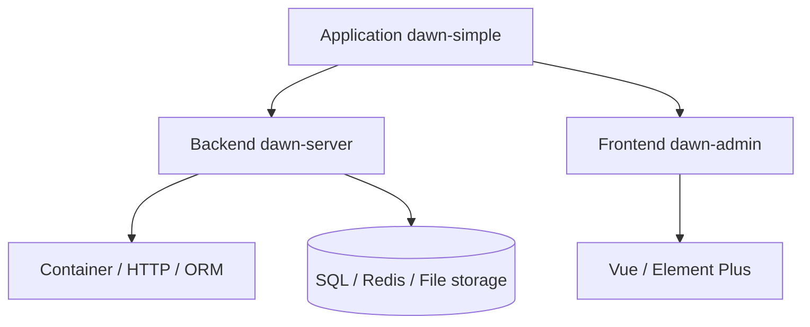

# Architecture

Dawn consists of a backend framework, a frontend component library, and an application template. Develop business features in dawn-simple and consume framework capabilities through dependencies.

## Application directories

| Path | Responsibility |
|---|---|
| `main.go`, `bootstrap/` | Command entry point, providers, routes, and migrations |
| `app/admin/menu.go` | Code menus, permissions, cache, and realtime extensions |
| `app/admin/routes.go` | Admin business routes |
| `app/admin/controllers/`, `middleware/` | Business requests and middleware |
| `app/web` | Website, community and business chat endpoints |
| `app/models/` | Shared entities, one file per entity |
| `app/constants/` | Business cache definitions and queue names |
| `app/providers/` | Container bindings, drivers, listeners, and translations |
| `app/cmd/`, `app/schedule/` | Custom commands and schedules |
| `routes/api.go` | Public business APIs |
| `database/migrations/`, `database/seeders/` | Schema migrations and base data |
| `config/` | Startup configuration organized by component namespace |
| `admin/src/` | Business pages, APIs, header components, and dashboards |
| `docs/` | Developer documentation |

Add `app/events`, `app/listeners`, and `app/jobs` as needed. Shared business operations may go in `app/services`; keep simple logic directly in its controller.

Define feature menus and permissions in code and deliver them with each version. Menus, pages, and APIs are reviewed and deployed together; role grants remain managed in the admin interface. Maintain external links and other custom entries through menu management.

## Application lifecycle

`main.go` dispatches commands to the application. `bootstrap` assembles providers, routes, migrations, and schedules. See [bootstrap/app.go](https://github.com/dawnim/dawn-simple/blob/main/bootstrap/app.go) and [bootstrap/extensions.go](https://github.com/dawnim/dawn-simple/blob/main/bootstrap/extensions.go).

`Register` declares lazy bindings; `Boot` registers drivers, commands, and listeners. The container creates and releases SQL, Redis, and filesystem resources. HTTP, CLI, and queue processes use the same configuration.

Each service process has its own Application and connection pools. Store shared state in SQL or Redis. Shutdown stops services and workers before releasing connections.

## Extension points

Extend `sdk.Options` inside `Configure` in `app/admin/menu.go`:

| Option | Extension |
|---|---|
| `Routes`, `PublicRoutes` | Admin and public business routes |
| `Menus`, `Permissions` | Page entries and operation permissions |
| `CacheKeys`, `Settings` | Business cache and settings |
| `Realtime` | Business WebSocket handlers |
| `WSValidate`, `WSAuthorize` | Identity validation and channel authorization |
| `LinkSystems` | Controlled external-system integration |

Use `createAdmin` to register frontend pages, translations, and header components while reusing layout, themes, requests, and permissions.

## Data and runtime

API fields use `snake_case`; timestamps use Unix milliseconds. Menu and permission keys are stable. The server assigns ownership, and reads and writes apply the same data scopes.

Migrations manage schemas; seeders fill base data. `dawn:install` runs migrations, seeding, and geolocation preparation. Deploy migration and seeder sources matching the binary.

`dawn:start all` runs HTTP, WS, Horizon, and cron in separate processes. `local` adds the frontend development server. See [Running services](runtime.md) for reloads and deployment, and [Backend](backend.md) and [Frontend](frontend.md) for integration.
