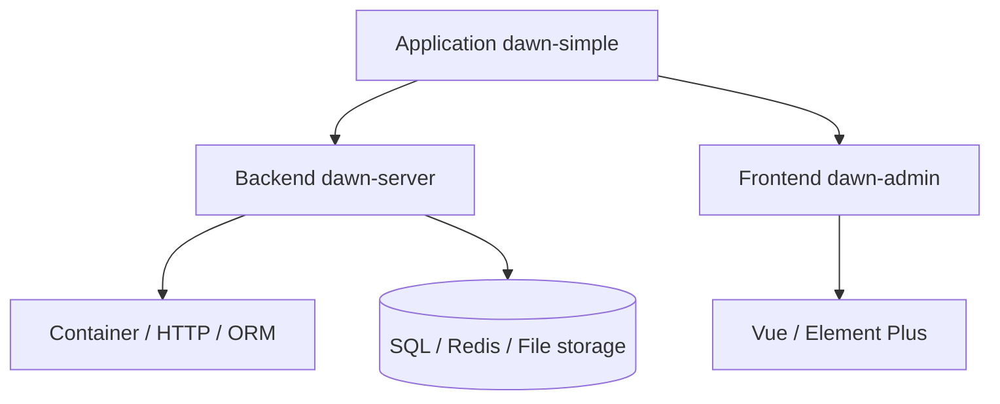

# Architecture

Dawn consists of a backend framework, a frontend component library, and an application template. Develop business features in dawn-simple and consume framework capabilities through dependencies.



## Repository layouts

### dawn-simple

The application. Its Go backend uses `dawn-server` and its admin frontend uses `@dawnim/admin`.

```text
dawn-simple/
|-- .github/                  # CI and documentation publishing
|-- main.go                   # Application command entry point
|-- bootstrap/                # Application, provider, and extension setup
|   |-- app.go                # Routes, commands, schedules, and migrations
|   |-- extensions.go         # Dawn extension and business model registration
|   `-- providers.go          # Application service providers
|-- app/
|   |-- admin/                # Admin business integration
|   |   |-- controllers/      # Admin APIs for posts and comments
|   |   |-- menu.go           # Admin menus, permissions, and settings
|   |   `-- routes.go         # Admin business routes
|   |-- cmd/                  # Application commands
|   |-- constants/            # Business cache keys and queue names
|   |-- exceptions/           # Application exception handling
|   |-- models/               # Forum business models
|   |-- momentcontent/        # Inline attachment parsing
|   |-- providers/            # Business service and translation registration
|   |-- schedule/             # Scheduled task registration
|   `-- web/                  # Website, forum, and chat APIs
|       `-- assets/           # Website assets embedded in Go
|-- admin/
|   `-- src/                  # Vue admin application
|       |-- main.ts           # Admin application entry point
|       |-- api/              # Business API clients
|       |-- assets/           # Application assets
|       |-- components/       # Shared application components
|       |-- locales/          # Business UI translations
|       `-- views/            # Business pages
|-- config/                   # Application and component configuration
|-- database/
|   |-- migrations/           # Business schema migrations
|   `-- seeders/              # Business seed data
|-- routes/
|   `-- api.go                # Public application routes
|-- docs/                     # Chinese guides and documentation site
|   |-- .vitepress/           # Build configuration, navigation, and theme
|   |-- en/                   # English guides
|   |-- prismgo/              # PrismGo documentation submodule
|   `-- public/               # Documentation assets
|-- public/                   # HTTP static files and built website docs
|-- storage/                  # Local runtime files
|-- tools/                    # Forum Markdown rendering, bundling, and tests
|-- go.mod                    # Go dependencies and versions
|-- nginx.conf                # Nginx deployment example
`-- supervisord*.conf         # Service process configuration examples
```

### dawn-server

The Go extension for PrismGo, providing admin APIs, public identity, files, chat, and service management.

```text
dawn-server/
|-- .github/                  # CI and releases
|-- provider.go               # PrismGo service provider and route entry point
|-- console.go                # Dawn command execution and service lifecycle
|-- app/
|   |-- admin/                # Admin runtime and public extension options
|   |   |-- controllers/      # Admin resources and reusable CRUD
|   |   |-- middleware/       # Authentication and authorization middleware
|   |   `-- response/         # HTTP response conventions
|   |-- cmd/                  # Install, code generation, schema, and service commands
|   |-- models/               # Extension models for users, permissions, files, and chat
|   `-- providers/            # Admin services, commands, and dependency bindings
|-- constants/                # Extension constants and cache keys
|-- database/
|   |-- migrations/           # Extension database migrations
|   |-- schema/               # Schema definition, checks, and synchronization
|   `-- seeders/              # Initial admin data
|-- realtime/                 # WebSocket connections and realtime message hub
|-- resources/
|   `-- prismgo-lens/         # Admin guidelines for PrismGo Lens
|-- routes/
|   `-- admin.go              # Admin and extension route registration
|-- support/
|   |-- authsession/          # Authentication sessions
|   |-- codegen/              # Resource code generator and templates
|   |-- customer/             # Customer support, chat, and AI
|   |-- geoip/                # IP geolocation
|   |-- i18n/                 # Translation and localization
|   |-- identity/             # Public identity and tickets
|   |-- settings/             # Runtime settings
|   |-- storage/              # File storage integration
|   `-- supervisor/           # Service processes and lifecycle management
|-- tests/                    # Integration tests and fixtures
|-- tools/
|   `-- embedding/            # Embedding model tooling
`-- go.mod                    # Go module, PrismGo, and other dependencies
```

### dawn-admin

The Vue admin library, published as `@dawnim/admin`, with a standalone Markdown editor.

```text
dawn-admin/
|-- .github/                  # CI and releases
|-- scripts/                  # Standalone editor and chat widget build scripts
|-- src/
|   |-- index.ts              # Public entry points including createAdmin
|   |-- api/                  # Framework admin API clients
|   |-- assets/               # Images, SVGs, and shared styles
|   |-- components/           # Layout, table, form, and Dawn components
|   |-- composables/          # Reusable composition logic
|   |-- config/               # Admin defaults
|   |-- dawn/                 # Shared Dawn frontend features
|   |   |-- CrudPage.vue      # Reusable resource management page
|   |   |-- Upload.vue        # Shared upload component
|   |   |-- crud/             # CRUD forms, filters, and lists
|   |   |-- editor.ts         # Standalone Markdown editor
|   |   |-- editor-bundle.ts  # Standalone editor bundle entry
|   |   |-- markdown.ts       # Default rendering and DOM enhancement
|   |   |-- chat.ts           # Admin chat integration
|   |   |-- realtime.ts       # Realtime connections and events
|   |   `-- lang/             # Shared component translations
|   |-- directives/           # Vue directives
|   |-- enums/                # Shared enumerations
|   |-- hooks/                # Table and UI hooks
|   |-- locales/              # Admin interface translations
|   |-- plugins/              # Third-party frontend plugin configuration
|   |-- router/               # Routing, navigation, and access control
|   |-- store/                # Pinia stores
|   |-- types/                # Frontend source types
|   |-- utils/                # Requests and utilities
|   `-- views/                # Built-in admin pages
|-- tests/                    # Component and runtime tests
|-- types/                    # Type declarations shipped with the npm package
|-- package.json              # npm dependencies and public subpaths
`-- vite.config.ts            # Development and bundling configuration
```

## Application lifecycle

`main.go` dispatches commands to the application. `bootstrap` assembles providers, routes, migrations, and schedules. See [bootstrap/app.go](https://github.com/dawnim/dawn-simple/blob/main/bootstrap/app.go) and [bootstrap/extensions.go](https://github.com/dawnim/dawn-simple/blob/main/bootstrap/extensions.go).

`Register` declares lazy bindings; `Boot` registers drivers, commands, and listeners. The container creates and releases SQL, Redis, and filesystem resources. HTTP, CLI, and queue processes use the same configuration.

Each service process has its own Application and connection pools. Store shared state in SQL or Redis. Shutdown stops services and workers before releasing connections.

## Extension points

Extend `sdk.Options` inside `Configure` in `app/admin/menu.go`:

| Option | Extension |
|---|---|
| `Routes`, `PublicRoutes` | Admin and public business routes |
| `Menus`, `Permissions` | Page entries and operation permissions |
| `CacheKeys`, `Settings` | Business cache and settings |
| `Realtime` | Business WebSocket handlers |
| `WSValidate`, `WSAuthorize` | Identity validation and channel authorization |
| `LinkSystems` | Controlled external-system integration |

Use `createAdmin` to register frontend pages, translations, and header components while reusing layout, themes, requests, and permissions.

## Data and runtime

API fields use `snake_case`; timestamps use Unix milliseconds. Menu and permission keys are stable. The server assigns ownership, and reads and writes apply the same data scopes.

Migrations manage schemas; seeders fill base data. `dawn:install` runs migrations, seeding, and geolocation preparation. Deploy migration and seeder sources matching the binary.

`dawn:start all` runs HTTP, WS, Horizon, and cron in separate processes. `local` adds the frontend development server. See [Running services](runtime.md) for reloads and deployment, and [Backend](backend.md) and [Frontend](frontend.md) for integration.
