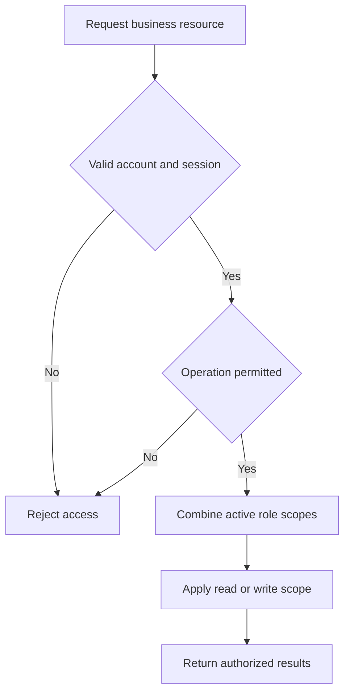

# Authorization and scopes

Authorization has three parts: operation permissions determine what an administrator can do, management levels determine which accounts and roles they may manage, and data scopes determine which records they may access.

## Authentication and sessions

Admin APIs use Bearer tokens. The shared frontend `request` handles tokens and refreshes. Access and refresh tokens both default to 30 days; configure them with `DAWN_ACCESS_TTL` and `DAWN_REFRESH_TTL`.

Authentication state uses PrismGo Session's Redis driver, including its encoding, optional encryption, expiry cleanup, and concurrency locks. No SQL authentication-session tables are created. Admin and regular users use separate namespaces, and visitor credentials are bound to their support application. Human support history remains in SQL `support_sessions`.

Set `SESSION_DRIVER=redis` in `.env`; other drivers cause startup to fail for built-in authentication. Standard PrismGo Session settings control connections, prefixes, encoding, encryption, and locks. `SESSION_CONNECTION=default` references `database.redis.default`, whose URL comes from `REDIS_URL`. Leave `SESSION_ENCODING` empty to follow `encoding.default`. `SESSION_LIFETIME` controls business Cookie Sessions, not built-in Bearer expiry. Authentication, business sessions, and clearable cache are isolated. Do not attach Session middleware to streaming or WebSocket routes.

Refresh tokens are single-use; rotation invalidates the old access and refresh tokens. Sign-out and device revocation invalidate both. Password changes, disabling, or deleting an account revoke all its devices. Session IDs identify devices and WS tickets; they are not access credentials. APIs check the current account and permissions. WebSocket uses HTTP-issued single-use tickets and rechecks authentication during messages and heartbeats.

Service restarts and reloads preserve sign-in. Keep Redis data and the Session connection, prefix, encoding, and encryption settings unchanged to reuse unexpired credentials. An invalid WS resume token returns 409; the client discards it and opens a new connection while staying signed in. Only invalid login credentials return 401 and trigger token refresh or sign-in.

The admin user page lists active devices and supports individual revocation. Super administrators may view all devices; regular administrators may view and revoke only their own and still need the relevant permissions. `GET /admin/sessions?cursor=0&page_size=10` returns `{data:[],meta:{cursor:"0"}}`; continue with a nonzero cursor. Redis scans may return fewer or more items than requested and do not supply an invented total. `DELETE /admin/sessions/{id}` revokes one device.

Configure Redis persistence, backups, and an eviction policy appropriate for authentication state. Losing Redis authentication data requires signing in again; chats, ratings, and knowledge remain in SQL. API messages follow the request's `Accept-Language`.

## Operation permissions

| Namespace | Purpose |
|---|---|
| `dawn.*` | Built-in framework features |
| `app.*` | Business menus and permissions defined in code |
| `custom.*` | Custom menus and operations created in admin |

Keys remain stable after creation. Code menus define pages; SQL stores role grants and custom menus. Frontend `v-permission` controls visibility; APIs independently enforce authorization.

Custom menus support directories, pages, buttons, and links. Page component paths match frontend `pages` registrations. Buttons participate in authorization under their menu. Links may open new windows or iframes; controlled systems can exchange single-use identity tickets and then check current permissions.

## Data scopes

Choose a scope in role management and assign the role to an administrator. Department scopes also require the account's department.

| Scope | Value | Accessible records |
|---|---|---|
| Self | `self` | Records created by the current administrator |
| Department | `department` | Own records and records in the account's department and descendants |
| Selected departments | `departments` | Own records and records in selected departments and descendants |
| All | `all` | All records allowed by the operation permission |

Active role scopes are combined as a union. Any `all` role grants the full scope; disabled roles do not participate. Department scope falls back to self for accounts without a department. Role changes apply from the next request.

`admin_users.super`, exposed as `is_super`, identifies super administrators with full admin operation and data-scope permissions. Member-based resources such as private chats still require membership.

## Integrate business tables

| Field | Contents |
|---|---|
| `created_by` | Creator admin ID, with the same type as the admin primary key |
| `department_id` | Owning department ID, with the same type as the department primary key; 0 if unassigned |

Use non-null indexed fields. `models.Base` provides the primary key, timestamps, and soft deletion; business models declare ownership fields.

The generator adapts to the schema:

| Business fields | Generated behavior |
|---|---|
| `created_by` | Self scope; department scopes fall back to self; `all` accesses all records |
| `created_by`, `department_id` | All four scopes |
| Only `department_id` | Department-based role scope; `all` accesses everything; self scope requires a creator column |
| Neither | Ordinary resource; add business scopes yourself |

For custom resources, filter with `Resource.Scope` and assign ownership with `Resource.Prepare`. See [Customize generated CRUD](backend.md#customize-generated-crud). Lists, counts, details, writes, deletions, exports, and downloads use the same scope.

Generic CRUD sets ownership on creation and import and preserves it on update. Moving an administrator to another department does not change existing record ownership. Custom controllers use `middleware.Actor(c).Scope(...)`; qualify columns in joins, such as `records.created_by`.

## Management levels

Larger role `level` values indicate higher management levels. Each administrator uses the highest level among their active roles. Regular administrators may manage and assign only strictly lower-level roles.

Account and role directories follow view permissions. Account writes additionally enforce data scopes and management levels. The current account, super administrators, peers, higher-level accounts, and out-of-scope accounts are read-only. Assigning existing lower-level roles follows role-assignment rules.

Attachments form a shared library. Regular administrators see only their own logs. Departments, positions, and other base settings use operation permissions; business records use their declared scopes.

## Authorization updates and cache

Profiles, permissions, and menus are cached per user for 4 hours, 2 hours, and 7 days respectively. Built-in account, role, position, and menu changes invalidate relevant caches after commit. Manual cache clearing and dashboard changes notify online clients through WebSocket.

After business code changes authorization data, call `a.ClearUserCaches(ctx, userID)` after committing. Omit IDs to clear all users. This increments authorization versions to prevent stale concurrent cache writes; existing sessions stay valid.

| Operation | API | Permission |
|---|---|---|
| Set dashboard | `PUT /admin/users/{id}/dashboard` | `dawn.users.dashboard` |
| Clear cache | `DELETE /admin/users/{id}/cache` | `dawn.users.cache` |
| Reset password | `PUT /admin/users/{id}/password` | `dawn.users.password` |
| Grant role permissions | `PUT /admin/roles/{id}/permissions` | `dawn.roles.permissions` |
