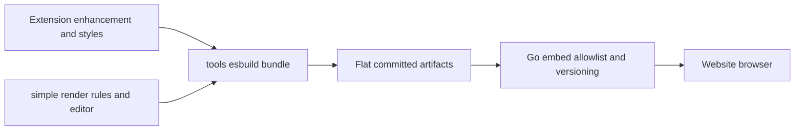
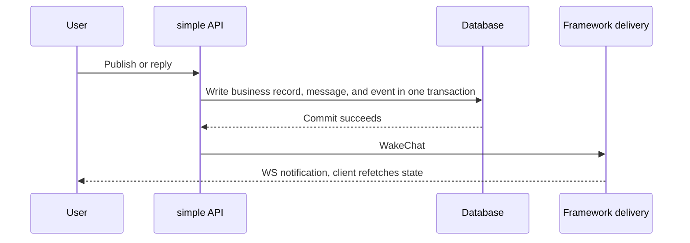

# Community example

The website root `/` is the community feed. `/dawn` keeps the product introduction, whose Start building button opens the docs. The clean three-column layout takes inspiration from Rhex and supports mobile, light/dark themes, and Chinese/English.

## Features and identity

Anyone can browse boards, search, activity/new/popular ordering, pagination, and post details. The website and support reuse one guest identity. Complete registration to publish, upload images, comment, reply, or chat. Public pages show `unique_id` as the user number.

The composer supports Moment and Post modes. Moment is selected by default for short text. Post mode adds a title, a two-pane Markdown editor, syntax-highlighted code, and live preview. The editor matches Rhex 1:1: 17 toolbar items (Rhex lock/encryption stays disabled by design), three preview views, fullscreen, line numbers, a floating selection toolbar, @mention autocomplete, and the full shortcut set. `Enter` continues lists, `Tab`/`Shift+Tab` changes indentation, `Alt+Up/Down` moves table rows, and drafts persist in `localStorage` with `Cmd/Ctrl+S`. Rendering also matches Rhex: markdown-it plugins cover footnotes, definition lists, abbreviations, super/subscript, inserted text, highlights, task lists, KaTeX math, callouts, and collapsible spoilers, plus click-to-reveal masks, `@user` links, custom emoji shortcodes, media markers, and Mermaid diagrams. Code blocks have language headers, copy buttons, and real highlight colors; headings get anchor IDs. Multi-block permission content, polls, lotteries, and paid attachments are Rhex business features and are not ported. Body images can be selected, pasted, or dropped, use the shared attachment upload endpoint, and are inserted at the cursor, while Moment mode keeps the WeChat-style “+” image grid. Moments allow 300 characters and posts allow 10,000. Authors can edit and soft-delete their own posts: both list rows and the detail page show Edit/Delete according to the server-side `can_manage` flag, backed by `PUT /api/moments/{id}` and `DELETE /api/moments/{id}` (which only writes `deleted_at`; the row, comments and reactions stay, and GORM hides deleted rows from lists and details). Deleting from a list refreshes in place; deleting from a detail page returns to the list. The gray region beside the author comes from server-side IP lookup: city, then province, then country, or Unknown. The location field is filled with the current IP region when the composer opens and remains editable. Comments also display the server-derived region.

Posts can be anonymous. The database keeps the real `user_id` for owner deletion, quotas, and administration, while public responses show “Anonymous user”; the required region remains visible. Moments do not expose the anonymous switch.
Anonymous posts use an anonymous sender in the chat hall, and comments do not open a private notification that would reveal the author.

Images on both list and detail pages open in a themed lightbox with double-click zoom, outside-click close, and a floating close button. The profile card uses the current request IP region and does not add a `last_ip` column to users.

Comments can reply to the post or another comment. Posts and comments use millisecond soft deletion; old chat cards remain, while deleted content opens a not-found message. Repeated flowers and eggs accumulate in one row per user/post without a notification for every click.

The Chat list pins the site-wide hall above recent private conversations. New posts appear in the hall. Comments and replies create cards in the participants' private chat, linking to the original post or comment; they can continue talking there. Guests may read the hall; members can send messages. Drafts persist per conversation and clear on identity change. History pagination, unread badges, monotonic read positions, and connection recovery are included.

## Tables and code

| Location | Responsibility |
|---|---|
| `app/models/moment*.go` | Three business tables: posts, comments, reactions |
| `database/migrations/202611140000_create_moments.go` | Initial schema snapshot |
| `bootstrap/extensions.go` | Register models for full schema checking/sync |
| `app/web/moments.go` | Community APIs, image ownership, IP regions, quotas |
| `app/web/moment_chat.go` | Reuse framework chat tables, events, and WS |
| `app/web/moment_ai.go`, `moment_job.go` | AI drafts and automated posts |
| `app/web/assets` | Website shell, community, chat, and docs bridge |
| `tools/moment_markdown.mjs`, `moment_bundle.mjs` | Post Markdown rules and the website IIFE entry |
| `tools/*.test.mjs` | Syntax golden cases, XSS regression, and bundle integrity |
| `tools/build_moment_markdown.sh` | Generate `moment-markdown.js` and `moment-markdown.css` |
| `app/admin/controllers/moments.go` | Admin resources, fields, and validation for posts and comments |
| `admin/src/api/business/moment*.ts`, `admin/src/views/business/moments` | Post CRUD page, comment dialog CRUD, resource APIs |
| `app/admin/menu.go` | Four CRUD permissions for each resource, all under `app.moments` |

Notifications and private chat reuse `chat_conversations`, `chat_members`, `chat_messages`, and `chat_events`. The community only adds three tables. Reactions have a unique `moment_id/user_id` pair; posts and comments reuse framework timestamps and soft deletion.

The admin menu is Customer service → Community moments, below Visitor management. Both posts and comments have full CRUD:

| Resource | Endpoint | Admin entry |
|---|---|---|
| Posts | `/admin/moments` | Framework `CrudPage`: search, sorting, pagination, create, edit, single/batch delete |
| Comments | `/admin/moment-comments` | A Comments button on each row opens that post's comment dialog with create, edit, delete, batch delete, search, and pagination |

Posts use the framework generic `crud.RegisterResource[models.Moment]` directly; only `Validate` adds format/board enums, title and length limits, the `images` JSON with a nine-image cap, and an existing-publisher check. Comments need exact `moment_id` and `user_id` filters (the framework default is LIKE), so only `ResourceHandlers.Index` is hand-written; `Show/Store/Update/Destroy` still reuse `BindResourceInput`, `CreateResource`, and `RegisterResourceRoutes`. Comment validation checks the post exists, the user exists, the reply target belongs to the same post, and the body length. Comments get no separate menu: all eight `app.moments.*` and `app.moment_comments.*` permissions hang from the `app.moments` node, and `hasAuth` controls button visibility.

This admin round added three generic extension capabilities: `CrudPage.actionWidth` (default 100, set to 220 for the Comments button), `formWidth` (dialog width, 1100px for the editor), and `Column.formSlot` (render one field through a named slot supplied by the page). Lists, toolbars, pagination, and permission checks stay in the framework; all business logic stays in simple.

Creating or editing a post mounts the **same editor core** as the website. The core ships the full Rhex skin (DOM, CSS, icons), 17 toolbar tools, three views, line numbers, fullscreen, shortcuts, the table grid, dialogs and @mentions. The website's static DOM is adopted in place; the admin generates the identical skin via `editorTemplate()`. Business code injects only the few capabilities that need outside involvement: `render`, `upload`, `mentions`, `config`, `previewImage`, `onChange`, `onSaveDraft`. On the website `format=moment` hides the toolbar and preview (300-character cap), while `format=post` allows 10,000; the admin passes `alwaysFull` so both formats keep the complete editor, with the same per-format caps. Admin uploads go through `/admin/attachments` under the admin identity, while mentions and tool settings still read the public `/api` endpoints, and drafts are keyed by record ID.

The admin replaces the raw `images` textarea with a thumbnail grid: existing images are fetched with the admin Bearer token and displayed as `blob:` URLs, and can be added or removed. Images uploaded from the editor are registered into `images` as well, otherwise the public `/api/moments/{id}/images/{image_id}` lookup by that array fails. The admin also shows an "Images in body" thumbnail strip below the editor, parsing `attachment://`, `upload://` and site image paths from the content, displaying them through the same authenticated `blob:` URLs and opening them on click. Those IDs are added to `images` automatically, so a picture visible in the admin preview is never broken on the website. `attachment://` references in the preview go through the same authenticated fetch, so a bare `` never gets a 401. The admin does not load the website dialect bundle; its preview uses the new framework-wide `renderMarkdown` (images and tables enabled, while chat rendering `renderChatMarkdown` still disables images), with inline images capped at 360px high.

## Editor, renderer, and extension boundary

**Business code lives in simple; reusable capabilities live in the extension.** `@dawnim/admin` holds framework-agnostic pieces only: `enhanceMarkdown` (code copy, heading anchors, masks, broken images, on-demand KaTeX/Mermaid), the shared `.markdown-body` stylesheet with light/dark highlight.js colors, and `createMarkdownEditor(root, opts)`—an editor core that **ships the complete skin and all features**: the original Rhex DOM/CSS/icons, 17 tools, three views, line numbers, the selection bar, table grid, dialogs, @mentions, shortcuts and fullscreen. Website and admin therefore share one 1:1 interface; business code injects only the render dialect, image upload and a handful of other external capabilities. `@dawnim/dawn-server` received one framework fix: `PATCH /admin/settings` now creates a settings group row on demand for groups registered by extensions, instead of failing with "record not found". Identity, `CheckUpload/SaveUpload/ServeAttachment`, GeoIP, settings, menus and chat already cover everything simple needs; another generic upload route would be redundant and would break `main` builds against the published module.

Emoji picking is also built into the core, with no admin-config indirection: `dawn-admin/src/dawn/emoji-data.ts` ships 1,914 base Unicode emoji (from `unicode-emoji-json`) in Telegram's order — Recently used, Smileys & People, Animals & Nature, Food & Drink, Activities, Travel & Places, Objects, Symbols, Flags. Clicking the smiley tool opens a popover anchored to the button (`position: fixed`, mounted inside the native `dialog` on the site and on `body` in the admin). **All groups render once into a single scroll container**: group names are `sticky` anchors, scrolling past the last row flows into the next group (and back upwards into the previous one), the bottom tab highlights itself as you scroll, and clicking a tab jumps straight to its anchor rather than re-rendering a single group. Clicking an emoji inserts the **character itself** and keeps the picker open for multiple picks; clicking outside or pressing `Esc` closes it, and recent picks persist in `localStorage`. Anchor names, empty state and the close label come from the editor's `zh`/`en` language pack and update immediately via `setOptions({ locale })`. The panel's `<form method="dialog">` stops `submit` from bubbling, so Cancel in the admin cannot trigger the host `ElForm`'s save. Hand-written `:smile:` shortcodes still work for legacy content; `moments.emoji_shortcodes` now serves only the renderer and is not read by the editor.

| Layer | Location | Responsibility |
|---|---|---|
| Extension | `dawn-admin/src/dawn/{markdown.ts,markdown.css,editor.ts,editor.css,emoji-data.ts}`, `src/index.ts` | DOM enhancement, shared typography, editor core with full skin and features (including built-in emoji data), chat/preview renderers |
| Business (render) | `tools/moment_markdown.mjs` | markdown-it plugin chain, custom syntax, sanitization |
| Business (bridge) | `tools/moment_bundle.mjs` | Exposes the core and render rules as `window.DawnMomentEditor` / `DawnMomentMarkdown` |
| Business (site) | `app/web/assets/{index.html,site.js,site.css}` | Publishing flow; injects render, upload, mentions, config, drafts |
| Business (admin) | `admin/src/views/business/moments/modules/{moment-editor.vue,moment-images.vue,attachments.ts}` | Vue shell; injects admin upload, mentions and render fallback; image thumbnails and attachment auth |
| Business (API) | `app/web/moments.go` | Publish/edit/config/mention search |

`tools/` is a self-contained npm project (`package.json` + `package-lock.json`). esbuild bundles the render rules, the extension's `enhanceMarkdown` and the editor core into `app/web/assets/moment-markdown.js`, and concatenates the extension stylesheets (`markdown.css` + `editor.css`) into `moment-markdown.css`. Both artifacts are committed. On `dev`, `sh tools/build_moment_markdown.sh` resolves the extension source through the `link:` dependency in `admin/node_modules/@dawnim/admin`; on `main`, the public package plus committed artifacts need no adjacent repository. KaTeX styles and the Mermaid runtime load from jsDelivr only when a post actually contains them; everything else is local.

The community hall reuses the same `DawnMomentMarkdown` engine: message bodies are rendered and passed to `enhanceMarkdown`, while conversation previews use the plain text of the rendered HTML with spoilers replaced by `•••`. Scoping nickname and card-link styles as `.chat-message > strong/button` keeps the site's global form styles from leaking into Markdown elements; headings, paragraphs, and code blocks are tightened inside the bubble. On desktop a `pointerdown` outside the panel closes it, matching the support widget; mobile stays open, and clicks inside the documentation iframe use the existing `postMessage` channel.

`//go:embed assets/*` only matches top-level files. New JS/CSS must be flat in `app/web/assets/`, added to the allowlist and sha256 version list in `app/web/web.go`, linked from `index.html`, and followed by a Go rebuild.

DOMPurify enforces the security boundary: `script/style/form/object`, event handlers, and inline styles are forbidden; `iframe src` is additionally checked against Bilibili, NetEase Cloud Music, YouTube, Tencent Video, and similar hosts; images accept site paths, `blob:`, and `http(s)` only. `html:true` therefore admits only the restricted HTML Rhex allows (`<u>`, `<center>`, `<p align>`, ruby, ...), which fixes the earlier escaped underline button and invalid `<p><div>` nesting without opening script injection. `node --test` in `tools/` covers syntax golden cases, eight XSS vectors, and bundle integrity; CI runs it in a dedicated job.

Admin System settings → Community configures the editor directly, with no new page:

| Setting | Format | Purpose |
|---|---|---|
| `moments.toolbar_hidden` | `media,alignment` | Hide buttons by Rhex tool key; empty shows all |
| `moments.emoji_shortcodes` | one `party=🎉` per line | Custom shortcodes resolved by the renderer when `:party:` is typed by hand; the emoji picker does not read this setting |

`GET /api/moment-config` delivers toolbar visibility and custom shortcodes (the latter only for legacy rendering), and `GET /api/mentions/search?q=` supplies mention candidates. Toolbar buttons and the help dialog share the same rules so documentation cannot drift from behavior.



## Public extension capabilities

Identity uses the extension's Session and single-use identity tickets instead of another login system. See [bidirectional identity](support-identity.md).

Images call `Controller.CheckUpload` with MD5, SHA-256, and size. A hit returns an attachment ID; otherwise `SaveUpload` uploads the bytes. Shared policies apply, and the unified file center stores user-scoped ownership. Publishing verifies every image belongs to the current user. Public image reads only serve attachments referenced by the post. See [attachment uploads](backend.md#reusing-attachment-uploads).



`Customer.Message` writes messages and delivery events within the business transaction. Call `WakeChat` after committing. Sending is idempotent by `request_id`. Reading private chats, advancing read positions, and delivering live events all enforce membership.

The widget exposes `menu/menuLayout` for Support/Chat entries. Business WS clients obtain tickets with `DawnSupport.createRealtimeTicket(resume)` and reconnect on `onSessionChange`. The application never reads private widget storage or hardcodes community menus, addresses, or endpoints into the shared script. See [Floating widget](chat.md#floating-widget).

## AI and quotas

Admin System settings → Community provides:

| Setting | Default | Purpose |
|---|---|---|
| `moments.daily_limit` | 2 | Posts per user/day; replies are unlimited |
| `moments.ai_daily_limit` | 23 | Site-wide manual draft requests/day, also capped at two per IP |
| `moments.auto_daily_limit` | 1 | Automated AI posts/day; 0 disables |
| `moments.brave_key` | Empty | Optional encrypted Brave Search key |
| `moments.toolbar_hidden` | Empty | Comma-separated editor tool keys to hide |
| `moments.emoji_shortcodes` | Five sample shortcodes | One `name=emoji` per line; resolves hand-written `:name:` only — the editor picker ships its own complete data |

Daily publishing quotas use the site process timezone, including deleted posts. Manual AI requests atomically reserve Redis quota before generation; failed requests also consume quota to prevent repeated model calls. Manual and automatic quotas are separate.

While reading documentation, Create with AI generates an editable draft of up to 300 characters from the current article. The user reviews and publishes it under their own account. Model calls reuse `Customer.GenerateText` and the `dawn` support application's configured protocol, model, and key. Model credentials never reach the browser.

An automatic job enters the existing serial queue every six hours. It samples recent documentation visits and coarse regions, then publishes a playful AI-first-person post under the labeled AI account, once a day by default. A configured Brave key adds recent technology stories; search failure falls back to documentation. With no readings or a zero automatic quota, nothing is generated.

## Running and reusing

For a fresh installation, follow [Quick start](quickstart.md). To deploy this version into an existing application, update schema and initialization definitions from the application root:

```sh
go run . migrate
go run . db:seed
npm --prefix tools ci
npm --prefix tools test
pnpm --dir docs build:all
pnpm --dir admin build
go run . dawn:start local
```

After changing `tools/moment_markdown.mjs` or the extension's `markdown.css`, run `sh tools/build_moment_markdown.sh` on `dev`, rebuild both artifacts, and commit them. `main` uses the committed artifacts directly.

HTTP serves the website/APIs and WS delivers messages. Horizon and cron process automated posts. `local` includes these services and the admin development frontend. See [Service runtime](runtime.md) for deployment and [Database schema](schema.md) for full schema synchronization.

Main business endpoints:

| Endpoint | Purpose |
|---|---|
| `GET/POST /api/moments` | List/publish with `format=moment/post` and `is_anonymous` |
| `GET/PUT/DELETE /api/moments/{id}` | Details/owner edit/owner soft deletion |
| `GET /api/moment-config`, `/api/mentions/search?q=` | Editor config and mention candidates |
| `GET/POST /api/moments/{id}/comments` | List comments/reply |
| `DELETE /api/moments/{id}/comments/{comment_id}` | Owner soft deletion |
| `POST /api/moments/{id}/reactions` | Accumulate `kind=flowers/eggs` |
| `POST /api/moment-image-checks`, `/api/moment-images` | Image preflight/upload |
| `GET /api/moment-location` | Current IP region |
| `POST /api/moment-drafts` | AI draft for current documentation |
| `GET/POST /api/community-chats` | Hall/recent chats/create private chat |
| `GET/POST /api/community-chats/{id}/messages` | History/send message |
| `PUT /api/community-chats/{id}/read` | Advance read position |

Replace the business models and content while retaining identity ownership, post-commit events, and quotas. Community behavior stays in the application; the extension provides reusable capabilities.
