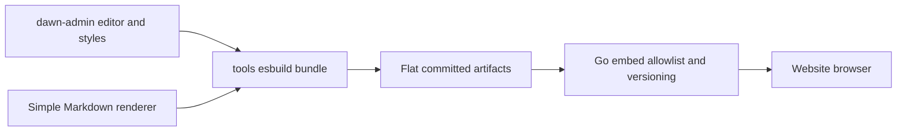
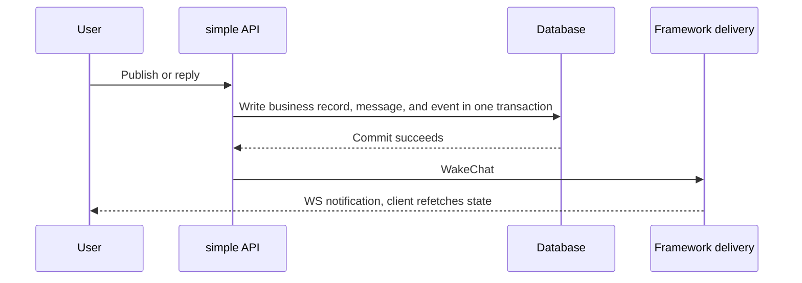

# Forum development example

The forum runs at `/`. The product introduction and docs entry are at `/dawn`. Simple implements the forum, its APIs, and admin pages, and uses Dawn extensions for identity, files, GeoIP, AI, and realtime chat.

## Browsing and posting

Guests can browse boards, search, and open topic details. The site and support widget share guest identity. Registered users can post, upload images, reply, and chat. Public pages use `unique_id` as the user number.

| Tab | List behavior |
|---|---|
| New posts | Default tab, most recently published first |
| New replies | Topics with at least one visible comment, latest comment first |
| Hot posts | Highest score first: comment count × 3 + flowers + eggs |
| Mine | Signed-in user's posts, most recently published first |

The composer opens in Moment mode, with a 1,024-character body limit. Post mode adds a title, anonymous publishing, and live Markdown preview, with a 10,000-character body limit. Both formats support a board, up to nine gallery images, and a location. The composer defaults to the current IP region, and the server supplies the region shown beside authors and comments.

The API returns `can_manage` for edit and delete buttons and checks ownership on writes. Topics and comments use soft deletion. Anonymous posts show “Anonymous user” in public, while the server keeps `user_id` for administration and quotas. Anonymous topics enter the chat hall with an anonymous sender, and replies respect the topic's anonymity.

Comments can reply to a topic or another comment. Flowers and eggs accumulate per user and topic. The Chat list pins the public hall, which receives cards for new topics. Comments and replies can send private chat cards linking back to the discussion. Guests can read the hall, and registered users can send messages. Chat supports paginated history, unread indicators, and reconnection.

## Tables and code

| Location | Responsibility |
|---|---|
| `app/models/moment*.go` | Three business tables: posts, comments, reactions |
| `database/migrations/202611140000_create_moments.go` | Initial schema snapshot |
| `bootstrap/extensions.go` | Register models for full schema checking/sync |
| `app/web/moments.go` | Community APIs, image ownership, IP regions, quotas |
| `app/web/moment_chat.go` | Reuse framework chat tables, events, and WS |
| `app/web/moment_ai.go`, `moment_job.go` | AI drafts and automated posts |
| `app/web/assets` | Website shell, community, chat, and docs bridge |
| `tools/moment_markdown.mjs`, `moment_bundle.mjs` | Post Markdown rules and the website IIFE entry |
| `tools/*.test.mjs` | Syntax golden cases, XSS regression, and bundle integrity |
| `tools/build_moment_markdown.sh` | Generate `moment-markdown.js` and `moment-markdown.css` |
| `app/admin/controllers/moments.go` | Admin resources, fields, and validation for posts and comments |
| `admin/src/api/business/moment*.ts`, `admin/src/views/business/moments` | Post CRUD page, comment dialog CRUD, resource APIs |
| `app/admin/menu.go` | Four CRUD permissions for each resource, all under `app.moments` |

Notifications and private chat reuse `chat_conversations`, `chat_members`, `chat_messages`, and `chat_events`. The community only adds three tables. Reactions have a unique `moment_id/user_id` pair; posts and comments reuse framework timestamps and soft deletion.

The admin menu is Customer service → Community moments, below Visitor management. Both posts and comments have full CRUD:

| Resource | Endpoint | Admin entry |
|---|---|---|
| Posts | `/admin/moments` | Framework `CrudPage`: search, sorting, pagination, create, edit, single/batch delete |
| Comments | `/admin/moment-comments` | A Comments button on each row opens that post's comment dialog with create, edit, delete, batch delete, search, and pagination |

Posts use the framework generic `crud.RegisterResource[models.Moment]` directly; only `Validate` adds format/board enums, title and length limits, the `images` JSON with a nine-image cap, and an existing-publisher check. Comments need exact `moment_id` and `user_id` filters (the framework default is LIKE), so only `ResourceHandlers.Index` is hand-written; `Show/Store/Update/Destroy` still reuse `BindResourceInput`, `CreateResource`, and `RegisterResourceRoutes`. Comment validation checks the post exists, the user exists, the reply target belongs to the same post, and the body length. Comments get no separate menu: all eight `app.moments.*` and `app.moment_comments.*` permissions hang from the `app.moments` node, and `hasAuth` controls button visibility.

The admin uses `CrudPage.actionWidth` and `formWidth` to size the action column and form. `Column.formSlot` binds a field to a named Vue slot in the page, which mounts the body editor or the gallery control.

## Editor and attachments

The site and admin reuse Dawn's Markdown editor and Simple's renderer. Simple selects image and media tools and enables image paste according to the post format. When inserting an image into the body, the editor calls Simple's uploader and inserts the returned markup. Simple manages the separate gallery, where users can upload or select existing images. Gallery IDs are saved in `images`.

Standard Markdown images use ``. Simple uses `[attachment://123]` for its own inline attachments. The renderer uses the attachment filename as `alt` and resolves the URL for the current record. Published images are publicly readable. The detail page skips gallery images already rendered in the body while preserving `images`. If the inline reference is removed, the image appears in the gallery again.

See [Markdown editor](editor.md) for the application extension points.

| Layer | Location | Responsibility |
|---|---|---|
| Extension | `dawn-admin/src/dawn/{markdown.ts,markdown.css,editor.ts,editor.css,emoji-data.ts}`, `src/index.ts` | DOM enhancement, shared typography, editor core with full skin and features (including built-in emoji data), chat/preview renderers |
| Business (render) | `tools/moment_markdown.mjs` | markdown-it plugin chain, custom syntax, sanitization |
| Business (bridge) | `tools/moment_bundle.mjs` | Exposes the core and render rules as `window.DawnMomentEditor` / `DawnMomentMarkdown` |
| Business (site) | `app/web/assets/{index.html,site.js,site.css}` | Publishing flow; injects render, upload, mentions, config, drafts |
| Business (admin) | `admin/src/views/business/moments/modules/{moment-editor.vue,moment-images.vue,attachments.ts}` | Vue shell; injects admin upload, mentions and the shared renderer; image thumbnails and attachment auth |
| Business (API) | `app/web/moments.go` | Publish/edit/config/mention search |

Install the renderer dependencies with `npm --prefix tools ci` before building either frontend. Run `sh tools/build_moment_markdown.sh` to copy the installed editor CSS and bundle the browser editor and Simple renderer for Go embedding. The admin imports the same renderer source.

Chat messages reuse the same Markdown renderer. DOMPurify sanitizes the rendered HTML, with allowlists for image URLs and media iframe sources. Run `npm --prefix tools test` to check syntax, HTML sanitization, and bundle integrity.

`GET /api/moment-config` provides toolbar settings and custom emoji shortcodes, and `GET /api/mentions/search?q=` provides mention suggestions. `moments.emoji_shortcodes` resolves shortcodes typed in the body. The editor picker uses its built-in emoji data.



## Public extension capabilities

Identity uses the extension's Session and single-use identity tickets instead of another login system. See [bidirectional identity](support-identity.md).

Images call `Controller.CheckUpload` with MD5, SHA-256, and size. A hit returns an attachment ID; otherwise `SaveUpload` uploads the bytes. Shared policies apply, and the unified file center stores user-scoped ownership. Public publishing and replies validate attachment ownership. The image endpoint for each post or comment serves attachments referenced by that record. See [attachment uploads](backend.md#reusing-attachment-uploads).



`Customer.Message` writes messages and delivery events within the business transaction. Call `WakeChat` after committing. Sending is idempotent by `request_id`. Reading private chats, advancing read positions, and delivering live events all enforce membership.

The widget exposes `menu/menuLayout` for Support/Chat entries. Business WS clients obtain tickets with `DawnSupport.createRealtimeTicket(resume)` and reconnect on `onSessionChange`. The application never reads private widget storage or hardcodes community menus, addresses, or endpoints into the shared script. See [Floating widget](chat.md#floating-widget).

## AI and quotas

Admin System settings → Community provides:

| Setting | Default | Purpose |
|---|---|---|
| `moments.daily_limit` | 2 | Posts per user/day; replies are unlimited |
| `moments.ai_daily_limit` | 23 | Site-wide manual draft requests/day, also capped at two per IP |
| `moments.auto_daily_limit` | 1 | Automated AI posts/day; 0 disables |
| `moments.brave_key` | Empty | Optional encrypted Brave Search key |
| `moments.toolbar_hidden` | Empty | Comma-separated editor tool keys to hide |
| `moments.emoji_shortcodes` | Five sample shortcodes | One `name=emoji` per line; resolves hand-written `:name:` only — the editor picker ships its own complete data |

Daily publishing quotas use the site process timezone, including deleted posts. Manual AI requests atomically reserve Redis quota before generation; failed requests also consume quota to prevent repeated model calls. Manual and automatic quotas are separate.

While reading documentation, Create with AI generates an editable draft from the current article. The user reviews and publishes it under their own account. Model calls reuse `Customer.GenerateText` and the `dawn` support application's configured protocol, model, and key. Model credentials never reach the browser.

An automatic job enters the existing serial queue every six hours. It samples recent documentation visits and coarse regions, then publishes a playful AI-first-person post under the labeled AI account, once a day by default. A configured Brave key adds recent technology stories; search failure falls back to documentation. With no readings or a zero automatic quota, nothing is generated.

## Running and reusing

For a fresh installation, follow [Quick start](quickstart.md). For local development, install dependencies, update the schema, and start services from the application root.

```sh
go run . migrate
go run . db:seed
npm --prefix tools ci
npm --prefix tools test
pnpm --dir docs install --frozen-lockfile
pnpm --dir docs build:all
pnpm --dir admin install --frozen-lockfile
pnpm --dir admin build
go run . dawn:start local
```

After changing `tools/moment_markdown.mjs` or the extension's `markdown.css`, run `sh tools/build_moment_markdown.sh` on `dev`, rebuild both artifacts, and commit them. `main` uses the committed artifacts directly.

HTTP serves the website/APIs and WS delivers messages. Horizon and cron process automated posts. `local` includes these services and the admin development frontend. See [Service runtime](runtime.md) for deployment and [Database schema](schema.md) for full schema synchronization.

Main business endpoints:

| Endpoint | Purpose |
|---|---|
| `GET/POST /api/moments` | List/publish with `format=moment/post` and `is_anonymous` |
| `GET/PUT/DELETE /api/moments/{id}` | Details/owner edit/owner soft deletion |
| `GET /api/moment-config`, `/api/mentions/search?q=` | Editor config and mention candidates |
| `GET/POST /api/moments/{id}/comments` | List comments/reply |
| `DELETE /api/moments/{id}/comments/{comment_id}` | Owner soft deletion |
| `POST /api/moments/{id}/reactions` | Accumulate `kind=flowers/eggs` |
| `POST /api/moment-image-checks`, `/api/moment-images` | Image preflight/upload |
| `GET /api/moment-location` | Current IP region |
| `POST /api/moment-drafts` | AI draft for current documentation |
| `GET/POST /api/community-chats` | Hall/recent chats/create private chat |
| `GET/POST /api/community-chats/{id}/messages` | History/send message |
| `PUT /api/community-chats/{id}/read` | Advance read position |

Replace the business models and content while retaining identity ownership, post-commit events, and quotas. Community behavior stays in the application; the extension provides reusable capabilities.
