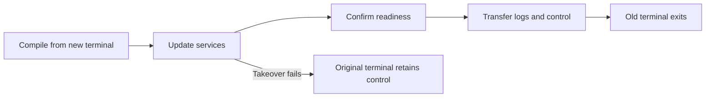

# Running services

Use `dawn:start local` for development and `dawn:start all` for production. HTTP, WS, Horizon, and cron run in separate processes; Dawn manages startup, shutdown, and failure recovery.

## Start and control

From the project root:

```sh
go run . dawn:start local
```

`local` starts the frontend development server and Go source watcher; frontend defaults are directory `admin` and port `5173`. `all` runs all backend services. Select a subset with commas, such as `http,ws,horizon`.

Run control commands in another terminal:

```sh
go run . dawn:start all status
go run . dawn:start horizon restart
go run . dawn:start http reload
go run . dawn:start ws reload
go run . dawn:start cron stop
go run . dawn:start cron
go run . dawn:start all stop
```

| Operation | Behavior |
|---|---|
| `start` | Start and supervise; the default when omitted |
| `stop` | Stop selected services and keep them stopped |
| `restart` | Stop, then start |
| `reload` | Start a new HTTP/WS process and hand over when ready |
| `status` | Show parent/child processes, PID/PPID, RSS, CPU, goroutines, user, threads, uptime, restarts, and latest errors |

Commands with the same runtime directory connect to the existing manager for the current project on this host. `all stop` stops every service, including local's frontend, and exits the manager. Ctrl+C or SIGTERM in the controlling terminal also initiates cleanup.

Failed services retry after 1, 2, and 4 seconds, up to a 30-second interval. A minute of stable operation resets backoff. Horizon manages its own workers; shutdown waits for tasks and follows native lease recovery.

Startup and control commands share service-table and log formatting. Go processes report goroutine counts through the project's local control channel; other processes show `—`. CPU is measured between samples: one fully utilized core is 100%, and multiple cores can exceed 100%. Initial and unavailable values show `—`. RSS is operating-system resident memory, distinct from Go heap usage. Metrics are sampled every 2 seconds; `status` reads the latest snapshot. Wide terminals show detail columns; narrower terminals use detail rows.

Use `--no-ansi` or `NO_COLOR=1` to disable colors. Redirected output defaults to plain text. For structured status:

```sh
go run . dawn:start all status --json
```

### Schema not ready

Before startup, Go services check required tables and columns in the application's complete target without DDL. If SQL is unreachable or structure is missing, the process remains alive in a waiting state and checks again every 5 seconds. Identical reasons are not repeatedly logged. The service is not ready and does not accept business requests. After repair, the same process continues without increasing its restart count. `status` and `stop` remain available.

For initial installation, run `go run . dawn:install` in another terminal. For upgrades, execute pending migrations. If a missing field was added inside an already executed migration, rerunning `migrate` will not replay it; preview with `dawn:schema check` and apply with `dawn:schema sync`. A reload candidate that fails readiness checks does not replace the old service.

A live process is not necessarily a ready service. Automated deployment should check both service status and actual health endpoints. A schema-waiting process is not evidence of a successful release.

## Source watcher

`local` watches Go sources and module files in the application and local `replace` modules. It combines rapid saves before compiling. Successful builds gracefully hand over HTTP/WS and restart Horizon and cron; the frontend keeps running. Compilation failures are displayed while existing services continue. Manually stopped services remain stopped.

Tests, documentation, frontend build output, and runtime directories do not trigger builds. Set `DAWN_GO_WATCH=false` to disable watching. Restart the manager after changing its own code or listening addresses.

## Terminal takeover

To transfer control to another terminal, run:

```sh
go run . dawn:start local
```

The new command loads its compiled services and takes over logs and Ctrl+C. The old terminal command exits. The manager stays alive, HTTP/WS hand over gracefully, and other services stop and restart in turn.



`terminal_pid` identifies the controlling process in `status`. CLI logs go to `storage/framework/local-cli.log`. Service output includes timestamps and service names, preserving multiline compilation and runtime errors. To update manager code or listener settings, run `go run . dawn:start local stop` and start again.

If the previous manager is shutting down, the terminal waits up to 30 seconds for its lock. The startup lock passes directly to the new manager to avoid concurrent launch conflicts. Startup failures print their detailed error before the terminal exits.

## Graceful reload

The manager owns HTTP/WS listeners. A new process inherits listeners and reports readiness before the old process drains. Failed startup leaves the old service running.

HTTP waits for in-flight requests up to `SERVER_SHUTDOWN_TIMEOUT`. WS spreads `1012` close notifications; clients reconnect and recover sessions, subscriptions, and acknowledgement positions from Redis. Recovery is bounded by retention time and count.

Process supervision and listener handover target Linux and macOS. In production, update the binary at its fixed path and reload or restart. `go run` uses the temporary binary from the current compilation. Listener-address changes require a manager restart.

## Frontend proxy

Local mode passes `DAWN_HTTP_TARGET`, `DAWN_WS_TARGET`, `DAWN_WS_PATH`, and `DAWN_ADMIN_PREFIX` to the frontend. The project's [Vite configuration](https://github.com/dawnim/dawn-simple/blob/main/admin/vite.config.ts) reads them; browsers access APIs and WS through the frontend port.

Use `DAWN_FRONTEND_DIRECTORY` and `DAWN_FRONTEND_PORT` to change directory and port. Vite uses a strict port and reports an error if occupied.

## Production deployment

Run `./deploy.sh root@server /srv/dawn-simple` from the project root on the build machine. The script builds the Linux binary, admin app, and documentation, then uploads them over SSH. The target server needs Bash, rsync, flock, Python with venv, and a configured project `.env`. The defaults are Linux amd64 and the `www` service account. Set `DEPLOY_ARCH` or `DEPLOY_USER` to override them.

Deployment runs installation and full database schema sync before updating the services. The script installs and starts the local embedding service. Once the model is ready, `app:support-docs --index` publishes the Chinese Dawn and PrismGo docs and rebuilds the website support index.

Build from the project root:

```sh
mkdir -p bin storage/logs
git submodule update --init --recursive
pnpm --dir docs install --frozen-lockfile
pnpm --dir docs build:site
pnpm --dir admin install --frozen-lockfile
pnpm --dir admin build
go build -o bin/dawn-simple .
./bin/dawn-simple dawn:install --force
./bin/dawn-simple dawn:start all
```

Keep `database/migrations` and `database/seeders` sources matching the binary. Run installation from one instance. Set production SQL, Redis, and `APP_KEY`; instances share connections, the application key, and file storage.

Go HTTP serves `/` (website), `/docs/` (documentation shell), `/site-assets/`, `/favicon.ico`, `/chat/`, and `/support-assets/`. Proxy these paths to HTTP so documentation navigation and support injection work. Proxy `/admin/` and `/api/` to HTTP and `/ws` to WS with Upgrade enabled. The default WS service path is `/`; rewrite `/ws` accordingly. Serve public attachments through `public/storage`; private attachments use authorized APIs.

If a hosting panel generates CSS and JS extension rules, give `/site-assets/`, `/support-assets/`, `/docs/`, and `/storage/` separate `location ^~` blocks that proxy to Go HTTP.

Add reverse proxies inside the site's `server` block:

```nginx
location ~ ^/(admin|api|chat|support-assets|site-assets|docs|storage)(/|$) {
    proxy_pass http://127.0.0.1:5123;
    proxy_set_header Host $host;
    proxy_set_header X-Real-IP $remote_addr;
    proxy_set_header X-Forwarded-For $proxy_add_x_forwarded_for;
    proxy_set_header X-Forwarded-Proto $scheme;
}

location = /favicon.ico {
    proxy_pass http://127.0.0.1:5123;
    proxy_set_header Host $host;
}

location = / {
    proxy_pass http://127.0.0.1:5123;
    proxy_set_header Host $host;
    proxy_set_header X-Forwarded-Proto $scheme;
}

location = /ws {
    proxy_pass http://127.0.0.1:8851/;
    proxy_http_version 1.1;
    proxy_set_header Upgrade $http_upgrade;
    proxy_set_header Connection "upgrade";
    proxy_set_header Host $host;
    proxy_set_header X-Forwarded-For $proxy_add_x_forwarded_for;
    proxy_set_header X-Forwarded-Proto $scheme;
    proxy_read_timeout 75s;
}
```

Production does not require Node/Vite. Keep the Go binary, `public/docs`, `admin/dist`, configuration, and matching migration/seeder sources. Building `admin/dist` does not copy website documentation. Go serves website assets and the favicon.

For a same-host proxy, set `SERVER_TRUSTED_PROXIES=127.0.0.1`; otherwise use the actual proxy IPs. Update corresponding `location` rules when changing API prefixes or WS paths.

### Combined supervision

Use [supervisord.conf](https://github.com/dawnim/dawn-simple/blob/main/supervisord.conf) to supervise the Dawn manager:

```sh
supervisord -c supervisord.conf
supervisorctl -c supervisord.conf status
supervisorctl -c supervisord.conf restart 'dawn-simple:*'
```

### Separate supervision

For separate service deployment, use [supervisord.split.conf](https://github.com/dawnim/dawn-simple/blob/main/supervisord.split.conf). Give each manager its own runtime directory:

```sh
DAWN_RUNTIME_DIRECTORY=storage/framework/http ./bin/dawn-simple dawn:start http
DAWN_RUNTIME_DIRECTORY=storage/framework/ws ./bin/dawn-simple dawn:start ws
DAWN_RUNTIME_DIRECTORY=storage/framework/http ./bin/dawn-simple dawn:start http reload
```

Choose combined or separate supervision for your deployment. Run one cron and one serial queue group per deployment; set `HORIZON_SERIAL=false` on additional Horizon instances and scale concurrent workers as needed.

## Logs

Application logs default to `storage/logs/dawn.log`; errors go to `storage/logs/error/`. An external process manager collects terminal output. See [Logs and monitoring](configuration.md#logs-and-monitoring) for channels, SQL logs, and monitoring.

## Optional embedding service

Run `go run . dawn:embedding install` once, then `go run . dawn:start embedding`. Set `EMBEDDING_ENABLED=true` to include it in all/local. Start, stop, restart, and status use the existing manager. Loading weights is a waiting state; normal startup does not install Python dependencies. See [Local embedding service](ai.md#local-embedding-service).
