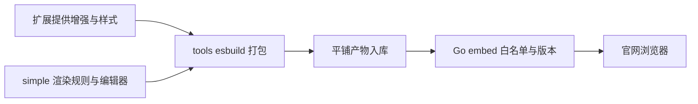
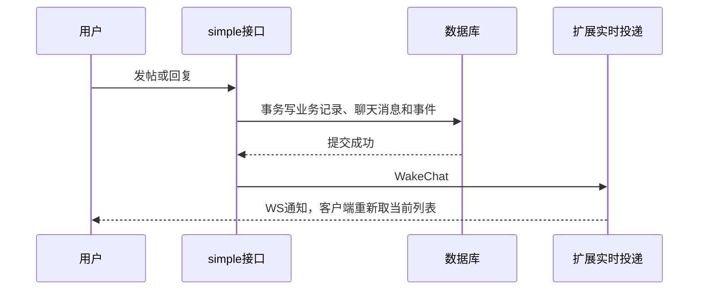

# 网站动态开发实例

官网根路径`/`是动态社区，`/dawn`保留产品介绍，介绍页的“开始构建”进入文档。社区参考Rhex的清爽三栏布局，支持手机、亮暗主题与中英文。

## 功能与身份

任何人可浏览板块、搜索、最新活动、新帖、热门、分页与详情。官网游客与客服复用身份；完善信息成为注册用户后，可以发帖、上传图片、评论、回复和聊天。公开页面使用`unique_id`展示用户编号。

发布窗口支持“动态”和“帖子”两种形式。动态默认选中，只写短正文；帖子支持标题、Markdown双栏编辑、代码高亮和实时预览。帖子编辑器按Rhex 1:1提供17项工具栏（Rhex的锁定/加密等按原有约定不启用）、三视图预览、全屏、行号、浮动选区工具条、@提及补全面板与完整快捷键；`Enter`续写列表、`Tab`/`Shift+Tab`调层级、`Alt+↑/↓`移动表格行，草稿写入`localStorage`并可用`Cmd/Ctrl+S`保存。渲染侧同样对齐Rhex：markdown-it插件链覆盖脚注、定义列表、缩写、上下标、插入、标记、任务列表、KaTeX公式、callout与折叠剧透，另有点击遮罩、`@用户`、自定义表情短码、媒体标记和Mermaid图表；代码块带语言头、复制按钮与高亮配色，标题自动生成锚点。锁定/加密、多块权限内容、投票抽奖与付费附件属Rhex业务能力，不移植。正文图片可通过按钮、粘贴或拖放上传，统一走附件上传接口并在光标处插入占位符，动态仍使用朋友圈式“+”图片格子。动态包含板块、1024字内正文、最多9张图片和选填地点；帖子正文上限为10000字。作者可以编辑、软删除自己已发布的帖子：列表行和详情页都按服务端下发的`can_manage`显示“编辑”“删除”，接口为`PUT /api/moments/{id}`与`DELETE /api/moments/{id}`（只写`deleted_at`，行数据、评论、点赞均保留，列表与详情由GORM自动过滤）；列表页删除后就地刷新，详情页删除后返回列表。作者旁的灰色属地由服务端按请求IP查询城市，缺少城市时依次使用省份、国家，定位失败显示“未知”；位置输入框打开发布窗口时默认填入当前IP属地，用户可调整。评论同样显示服务端属地。

帖子可以选择匿名发布。数据库仍保存真实`user_id`用于本人删除、额度和后台追溯，公开列表只显示“匿名用户”，属地仍按要求展示。动态不提供匿名开关。
匿名动态进入聊天大厅时使用匿名发送主体，评论不会通过私聊暴露匿名作者身份。

列表页和详情页的图片都支持点击灯箱、双击放大、点击外部关闭和右上角关闭；图片查看层跟随亮暗主题。右侧用户卡片的属地使用当前请求IP，用户表不另存`last_ip`字段。

评论可以回复主题或其他评论。主题与评论使用毫秒软删除，旧聊天卡片仍保留，打开已删除内容会提示不存在。鲜花和鸡蛋允许连续点击，每人每帖只保存一条累计记录，不逐次发通知。

“聊天”列表置顶全站大厅，其余为最近私聊。新动态进入大厅；评论和回复进入双方私聊，消息卡片可以定位到原帖或具体评论，也可直接继续聊天。游客可浏览大厅，注册用户可以发言。输入草稿按会话保留，切换身份清理；消息支持历史分页、未读、单调已读与断线恢复。

## 表与代码

| 位置 | 职责 |
|---|---|
| `app/models/moment*.go` | 动态、评论、鲜花鸡蛋三张业务表 |
| `database/migrations/202611140000_create_moments.go` | 首次表结构快照 |
| `bootstrap/extensions.go` | 将业务模型接入完整结构检查与同步 |
| `app/web/moments.go` | 社区接口、附件归属、IP属地与发布额度 |
| `app/web/moment_chat.go` | 复用框架聊天表、事件与WS |
| `app/web/moment_ai.go`、`moment_job.go` | AI草稿与自动动态 |
| `app/web/assets` | 官网外壳、社区、聊天与文档桥接 |
| `tools/moment_markdown.mjs`、`tools/moment_bundle.mjs` | 帖子Markdown渲染规则与官网IIFE入口 |
| `tools/moment_markdown.test.mjs`、`moment_bundle.test.mjs` | 语法golden用例、XSS回归与产物校验 |
| `tools/build_moment_markdown.sh` | 生成`moment-markdown.js`与`moment-markdown.css` |
| `app/admin/controllers/moments.go` | 后台动态与评论两套资源接口、字段与校验 |
| `admin/src/api/business/moment*.ts`、`admin/src/views/business/moments` | 动态CRUD页、评论弹窗CRUD与资源API |
| `app/admin/menu.go` | 动态、评论各四个CRUD权限，统一挂在`app.moments`下 |

不另建通知表或私聊表，直接使用扩展的`chat_conversations`、`chat_members`、`chat_messages`与`chat_events`。业务只定义三张社区表，互动表以`moment_id/user_id`唯一，主题与评论共用框架基础时间和软删除字段。

后台菜单位于“客户服务→网友动态”，在访客管理下方。动态和评论都提供完整的增删改查：

| 资源 | 接口 | 后台入口 |
|---|---|---|
| 动态 | `/admin/moments` | 复用框架`CrudPage`：搜索、排序、分页、新增、编辑、单条与批量删除 |
| 评论 | `/admin/moment-comments` | 每行“评论”按钮打开当前帖子的评论弹窗，弹窗内新增、编辑、删除、批量删除、搜索与分页 |

动态直接用框架泛型`crud.RegisterResource[models.Moment]`，只在`Validate`里补齐形式/板块枚举、标题与字数上限、`images` JSON 与最多9张、发布用户必须存在。评论因为`moment_id`、`user_id`要精确过滤（框架默认是 LIKE），只手写`ResourceHandlers.Index`；`Show/Store/Update/Destroy`仍复用框架的`BindResourceInput`、`CreateResource`与`RegisterResourceRoutes`。评论校验覆盖帖子存在、用户存在、回复目标必须属于同一帖子和正文字数。评论不另设菜单，`app.moments.*`与`app.moment_comments.*`八项权限都挂在`app.moments`节点下，前端按`hasAuth`控制按钮显隐。

后台这轮对扩展做了三处通用增强：`CrudPage`的`actionWidth`（默认100，业务传220容纳“评论”按钮）、`formWidth`（弹窗宽度，编辑器页传1100px）和`Column.formSlot`（按字段把控件交给具名`setOptions`插槽）。列表、工具栏、分页与权限判断全部沿用框架组件，业务逻辑仍只在simple。

## 编辑器与附件

官网和后台使用同一套编辑器与 Simple 的 Markdown 渲染规则。动态正文上限为1024字，图片通过独立图库添加。帖子正文上限为10000字，可在正文插入图片和媒体，也可粘贴图片。图库独立上传或从历史图片中选择，图片ID保存到`images`。

Simple 将站内正文图片写成`[attachment://123]`，帖子和评论也支持标准 Markdown 图片。渲染站内附件时，Simple 用附件名（上传时取原始文件名）作为`alt`，按当前页面解析图片地址。已发布图片可以直接浏览。详情页正文和图库引用同一附件时只展示一次，图库记录照常保存。移除正文引用后，该图会重新显示在下方图库。

编辑器扩展方式见[Markdown 编辑器](editor.md)。

| 层 | 位置 | 职责 |
|---|---|---|
| 框架 | `dawn-admin/src/dawn/{markdown.ts,markdown.css,editor.ts,editor.css,emoji-data.ts}`、`src/index.ts` | DOM增强、通用排版、自带皮肤与全功能的编辑器内核（含内置表情数据）、聊天与预览两种渲染器 |
| 业务（渲染） | `tools/moment_markdown.mjs` | markdown-it插件链、自定义语法、白名单净化 |
| 业务（桥接） | `tools/moment_bundle.mjs` | 把内核与渲染规则暴露为`window.DawnMomentEditor` / `DawnMomentMarkdown` |
| 业务（官网） | `app/web/assets/{index.html,site.js,site.css}` | 发帖流程；注入渲染、上传、@候选、配置、草稿 |
| 业务（后台） | `admin/src/views/business/moments/modules/{moment-editor.vue,moment-images.vue,attachments.ts}` | Vue薄壳；注入管理员上传、提及和共享渲染器；图片缩略图与附件鉴权 |
| 业务（接口） | `app/web/moments.go` | 发布/编辑/配置/提及搜索 |

构建官网和后台前执行`npm --prefix tools ci`。`sh tools/build_moment_markdown.sh`使用已安装的编辑器产物，与 Simple 渲染规则一起打包，并复制共享 CSS 供 Go 内嵌。后台直接导入同一份渲染源码。

聊天大厅复用同一个`DawnMomentMarkdown`：消息正文渲染后交给`enhanceMarkdown`，会话列表摘要取渲染结果的纯文本、剧透替换为`•••`。气泡内的昵称与卡片链接用`.chat-message > strong/button`限定，避免官网全局表单样式污染Markdown元素；标题、段落与代码块收紧间距。桌面宽度点击浮层外部（`pointerdown`）即收起，与客服widget一致；移动端不自动收起，文档iframe内的点击沿用既有`postMessage`通道。

`//go:embed assets/*`只匹配顶层文件。新增JS/CSS必须平铺放进`app/web/assets/`，同时改`app/web/web.go`的资源白名单与sha256版本列表、在`index.html`引入，并重新编译Go二进制。

安全由DOMPurify白名单统一承担：禁用`script/style/form/object`、事件属性与内联样式，`iframe`的`src`额外校验B站、网易云、YouTube、腾讯视频等域名，图片只允许站内路径、`blob:`与`http(s)`。`html:true`因此只放行Rhex允许的受限HTML（`<u>`、`<center>`、`<p align>`、ruby等），既修掉早期“下划线按钮被转义”和`<p><div>`非法嵌套，也不会放开脚本注入。`tools/`的`node --test`覆盖语法golden用例、8类XSS和产物完整性，CI单独跑这个job。

后台“系统设置→网友动态”可直接配置编辑器，无需新页面：

| 配置 | 格式 | 用途 |
|---|---|---|
| `moments.toolbar_hidden` | `media,alignment` | 按Rhex的工具key隐藏按钮，留空显示全部 |
| `moments.emoji_shortcodes` | 每行`party=🎉` | 自定义表情短码，正文手写`:party:`时由渲染层替换；编辑器表情面板不读此配置 |

`GET /api/moment-config`下发工具栏隐藏与自定义短码（后者只给渲染层兼容旧内容），`GET /api/mentions/search?q=`提供@候选；工具栏按钮与帮助弹层用同一套规则，避免文档与实现不一致。



## 公开能力的接入

身份使用扩展的Session与一次性身份票据，不复制登录机制。详见[双向身份接入](support-identity.md)。

图片先用MD5、SHA-256和大小调用`Controller.CheckUpload`，命中直接取得附件ID；未命中才调用`SaveUpload`。文件遵循统一上传策略，保存到后台文件中心，使用用户Scope隔离归属。发布时验证所有图片属于当前用户；公开图片接口只读取该动态已引用的附件。详见[附件上传](backend.md#复用附件上传)。



使用`Customer.Message`在同一事务内保存消息和投递事件，提交后调用`WakeChat`。发送消息用`request_id`幂等；读取私聊、推进已读与实时投递均验证当前成员。

widget通过公开的`menu/menuLayout`配置接入“客服/聊天”，业务实时连接通过`DawnSupport.createRealtimeTicket(resume)`获取票据；不读取widget私有存储，也不向公共脚本硬编码社区菜单、地址或业务接口。身份变化通过`onSessionChange`重建连接，参见[悬浮入口](chat.md#悬浮入口)。

## AI与额度

后台“系统设置→网友动态”提供：

| 配置 | 默认值 | 用途 |
|---|---|---|
| `moments.daily_limit` | 2 | 每用户每天发布动态次数，回复不限 |
| `moments.ai_daily_limit` | 23 | 全站每天手动AI草稿请求总量，每IP另外限制2次 |
| `moments.auto_daily_limit` | 1 | 每天AI账号自动发布上限，0关闭 |
| `moments.brave_key` | 空 | 可选Brave Search密钥，加密保存 |
| `moments.toolbar_hidden` | 空 | 逗号分隔的编辑器工具key，隐藏对应按钮 |
| `moments.emoji_shortcodes` | 5个示例短码 | 每行`名称=表情`，仅渲染层替换手写`:名称:`；编辑器表情面板内置完整数据，不依赖此项 |

发布额度按站点进程时区的自然日计算，删除后不返还。AI草稿请求通过Redis原子计数预占额度，失败也计次，避免重试刷模型；手动与自动额度分开。

阅读文档时可点“AI写动态”，根据当前文章生成1024字内草稿，允许编辑后发布到本人动态。模型请求复用`Customer.GenerateText`及`dawn`客服应用的模型、协议和密钥配置，前端不持有模型密钥。

自动任务每6小时加入现有串行队列，随机选取最近文档阅读路径和大致地区，以AI账号第一人称发布俏皮短文，默认每天最多1条，明确标识AI。配置Brave密钥后加入最近一周科技趣闻素材；搜索失败仍按文档生成。没有阅读记录或关闭自动额度时不生成。

## 运行与复用

首次安装按[快速开始](quickstart.md)执行。已有应用部署这版代码时，在应用根目录更新结构与初始化定义：

```sh
go run . migrate
go run . db:seed
npm --prefix tools ci
npm --prefix tools test
pnpm --dir docs build:all
pnpm --dir admin build
go run . dawn:start local
```

修改`tools/moment_markdown.mjs`或框架的`markdown.css`后，在`dev`分支执行`sh tools/build_moment_markdown.sh`重建两份产物并提交；`main`分支直接使用已提交产物。

HTTP提供官网与接口，WS负责实时消息；Horizon和cron负责自动动态。`local`包含这些服务及后台开发前端。正式部署见[服务运行](runtime.md)，已有表的完整定义同步见[数据库结构](schema.md)。

主要业务接口：

| 接口 | 用途 |
|---|---|
| `GET/POST /api/moments` | 列表与发布，发布时使用`format=moment/post`和`is_anonymous` |
| `GET/PUT/DELETE /api/moments/{id}` | 详情、本人编辑与本人软删除 |
| `GET /api/moment-config`、`/api/mentions/search?q=` | 编辑器配置与@候选用户 |
| `GET/POST /api/moments/{id}/comments` | 评论列表与回复 |
| `DELETE /api/moments/{id}/comments/{comment_id}` | 本人评论软删除 |
| `POST /api/moments/{id}/reactions` | `kind=flowers/eggs`累计 |
| `POST /api/moment-image-checks`、`/api/moment-images` | 图片秒传预检与上传 |
| `GET /api/moment-location` | 当前IP属地 |
| `POST /api/moment-drafts` | 当前文档AI草稿 |
| `GET/POST /api/community-chats` | 大厅、最近私聊与创建私聊 |
| `GET/POST /api/community-chats/{id}/messages` | 历史分页与发消息 |
| `PUT /api/community-chats/{id}/read` | 推进已读位置 |

复制此实例时替换业务模型与前端内容，保留身份归属、事务后通知与额度控制。所有社区行为留在应用中，公共扩展负责可复用能力。
