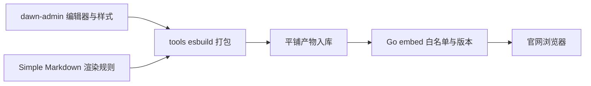
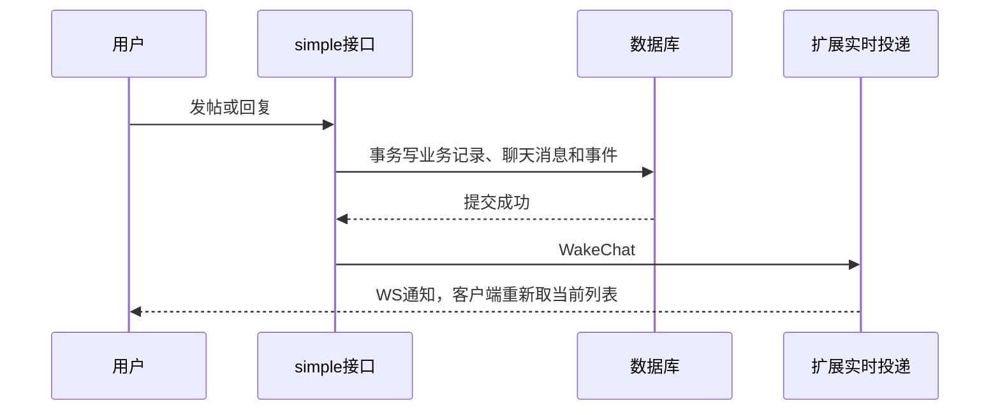

# 论坛动态开发实例

官网根路径`/`运行论坛，`/dawn`展示产品介绍及文档入口。论坛页面、业务接口和后台管理由 Simple 实现，身份、文件、GeoIP、AI 和实时聊天复用 Dawn 扩展。

## 浏览和发帖

访客可以浏览板块、搜索和查看详情。官网和客服共用访客身份，完成注册后可以发帖、上传图片、评论和聊天。公开页面使用 `unique_id` 展示用户编号。

| 页签 | 列表规则 |
|---|---|
| 新动态 | 默认页签，最新发布优先 |
| 新评论 | 仅显示有未删除评论的主题，按最后评论时间倒序 |
| 热门贴 | 按评论数 × 3 + 鲜花数 + 鸡蛋数倒序 |
| 我发的 | 登录后按当前作者筛选，最新发布优先 |

发布窗口默认选择“动态”，正文最多 1024 字。切换到“帖子”后可以填写标题、匿名发布和使用 Markdown 实时预览，正文最多 10000 字。两种形式都可选板块、添加最多 9 张图库图片和填写地点。地点默认取当前 IP 属地；作者和评论旁的属地按服务端查询结果展示。

编辑和删除按钮由接口的 `can_manage` 控制，服务端校验归属。主题和评论使用软删除。匿名帖子公开展示“匿名用户”，服务端保留 `user_id` 用于管理和额度计算。匿名主题进入聊天大厅时使用匿名发送人，评论也遵守该主题的匿名规则。

评论可回复主题或其他评论。鲜花、鸡蛋按用户和主题累计。大厅置顶展示在“聊天”列表，发布主题后向大厅投递卡片，评论和回复可向双方私聊投递定位到原帖的卡片。访客可浏览大厅，注册用户可以发言。聊天支持历史分页、未读与断线恢复。

## 表与代码

| 位置 | 职责 |
|---|---|
| `app/models/moment*.go` | 动态、评论、鲜花鸡蛋三张业务表 |
| `database/migrations/202611140000_create_moments.go` | 首次表结构快照 |
| `bootstrap/extensions.go` | 将业务模型接入完整结构检查与同步 |
| `app/web/moments.go` | 社区接口、附件归属、IP属地与发布额度 |
| `app/web/moment_chat.go` | 复用框架聊天表、事件与WS |
| `app/web/moment_ai.go`、`moment_job.go` | AI草稿与自动动态 |
| `app/web/assets` | 官网外壳、社区、聊天与文档桥接 |
| `tools/moment_markdown.mjs`、`tools/moment_bundle.mjs` | 帖子Markdown渲染规则与官网IIFE入口 |
| `tools/moment_markdown.test.mjs`、`moment_bundle.test.mjs` | 语法golden用例、XSS回归与产物校验 |
| `tools/build_moment_markdown.sh` | 生成`moment-markdown.js`与`moment-markdown.css` |
| `app/admin/controllers/moments.go` | 后台动态与评论两套资源接口、字段与校验 |
| `admin/src/api/business/moment*.ts`、`admin/src/views/business/moments` | 动态CRUD页、评论弹窗CRUD与资源API |
| `app/admin/menu.go` | 动态、评论各四个CRUD权限，统一挂在`app.moments`下 |

不另建通知表或私聊表，直接使用扩展的`chat_conversations`、`chat_members`、`chat_messages`与`chat_events`。业务只定义三张社区表，互动表以`moment_id/user_id`唯一，主题与评论共用框架基础时间和软删除字段。

后台菜单位于“客户服务→网友动态”，在访客管理下方。动态和评论都提供完整的增删改查：

| 资源 | 接口 | 后台入口 |
|---|---|---|
| 动态 | `/admin/moments` | 复用框架`CrudPage`：搜索、排序、分页、新增、编辑、单条与批量删除 |
| 评论 | `/admin/moment-comments` | 每行“评论”按钮打开当前帖子的评论弹窗，弹窗内新增、编辑、删除、批量删除、搜索与分页 |

动态直接用框架泛型`crud.RegisterResource[models.Moment]`，只在`Validate`里补齐形式/板块枚举、标题与字数上限、`images` JSON 与最多9张、发布用户必须存在。评论因为`moment_id`、`user_id`要精确过滤（框架默认是 LIKE），只手写`ResourceHandlers.Index`；`Show/Store/Update/Destroy`仍复用框架的`BindResourceInput`、`CreateResource`与`RegisterResourceRoutes`。评论校验覆盖帖子存在、用户存在、回复目标必须属于同一帖子和正文字数。评论不另设菜单，`app.moments.*`与`app.moment_comments.*`八项权限都挂在`app.moments`节点下，前端按`hasAuth`控制按钮显隐。

后台通过 `CrudPage` 的 `actionWidth` 和 `formWidth` 调整列宽与表单宽度。字段用 `Column.formSlot` 绑定页面的 Vue 具名插槽，分别挂载正文编辑器和图库控件。

## 编辑器与附件

官网和后台复用 Dawn 的 Markdown 编辑器及 Simple 的渲染规则。Simple 按发布形式设置图片、媒体按钮和粘贴上传开关。上传到正文时，编辑器调用 Simple 的上传回调，再把返回的引用插入正文。下方图库由 Simple 独立管理，可上传或选择已有图片，图片 ID 保存到 `images`。

标准 Markdown 图片使用 ``。Simple 的站内正文附件使用 `[attachment://123]`，渲染时根据附件 ID 获取文件名作为 `alt`，并解析当前记录对应的图片地址。已发布图片可公开浏览。详情页只在渲染图库时跳过正文中已展示的附件 ID，`images` 保留原值。移除正文引用后，该图会重新出现在图库。

编辑器扩展方式见[Markdown 编辑器](editor.md)。

| 层 | 位置 | 职责 |
|---|---|---|
| 框架 | `dawn-admin/src/dawn/{markdown.ts,markdown.css,editor.ts,editor.css,emoji-data.ts}`、`src/index.ts` | DOM增强、通用排版、自带皮肤与全功能的编辑器内核（含内置表情数据）、聊天与预览两种渲染器 |
| 业务（渲染） | `tools/moment_markdown.mjs` | markdown-it插件链、自定义语法、白名单净化 |
| 业务（桥接） | `tools/moment_bundle.mjs` | 把内核与渲染规则暴露为`window.DawnMomentEditor` / `DawnMomentMarkdown` |
| 业务（官网） | `app/web/assets/{index.html,site.js,site.css}` | 发帖流程；注入渲染、上传、@候选、配置、草稿 |
| 业务（后台） | `admin/src/views/business/moments/modules/{moment-editor.vue,moment-images.vue,attachments.ts}` | Vue薄壳；注入管理员上传、提及和共享渲染器；图片缩略图与附件鉴权 |
| 业务（接口） | `app/web/moments.go` | 发布/编辑/配置/提及搜索 |

构建官网和后台前执行`npm --prefix tools ci`。`sh tools/build_moment_markdown.sh`使用已安装的编辑器产物，与 Simple 渲染规则一起打包，并复制共享 CSS 供 Go 内嵌。后台直接导入同一份渲染源码。

聊天消息也使用同一个 Markdown 渲染器。渲染结果由 DOMPurify 净化，图片地址和媒体 iframe 来源另有白名单。运行 `npm --prefix tools test` 检查语法、HTML 净化和产物完整性。

`GET /api/moment-config` 下发工具栏配置与自定义表情短码，`GET /api/mentions/search?q=` 提供 @ 提及候选。`moments.emoji_shortcodes` 用于渲染手写的短码，编辑器表情面板使用内置表情数据。



## 公开能力的接入

身份使用扩展的Session与一次性身份票据，不复制登录机制。详见[双向身份接入](support-identity.md)。

图片先用MD5、SHA-256和大小调用`Controller.CheckUpload`，命中直接取得附件ID；未命中才调用`SaveUpload`。文件遵循统一上传策略，保存到后台文件中心，使用用户Scope隔离归属。公开发帖和回复时验证附件归属。帖子与评论各自的图片接口读取对应记录引用的附件。详见[附件上传](backend.md#复用附件上传)。



使用`Customer.Message`在同一事务内保存消息和投递事件，提交后调用`WakeChat`。发送消息用`request_id`幂等；读取私聊、推进已读与实时投递均验证当前成员。

widget通过公开的`menu/menuLayout`配置接入“客服/聊天”，业务实时连接通过`DawnSupport.createRealtimeTicket(resume)`获取票据；不读取widget私有存储，也不向公共脚本硬编码社区菜单、地址或业务接口。身份变化通过`onSessionChange`重建连接，参见[悬浮入口](chat.md#悬浮入口)。

## AI与额度

后台“系统设置→网友动态”提供：

| 配置 | 默认值 | 用途 |
|---|---|---|
| `moments.daily_limit` | 2 | 每用户每天发布动态次数，回复不限 |
| `moments.ai_daily_limit` | 23 | 全站每天手动AI草稿请求总量，每IP另外限制2次 |
| `moments.auto_daily_limit` | 1 | 每天AI账号自动发布上限，0关闭 |
| `moments.brave_key` | 空 | 可选Brave Search密钥，加密保存 |
| `moments.toolbar_hidden` | 空 | 逗号分隔的编辑器工具key，隐藏对应按钮 |
| `moments.emoji_shortcodes` | 5个示例短码 | 每行`名称=表情`，仅渲染层替换手写`:名称:`；编辑器表情面板内置完整数据，不依赖此项 |

发布额度按站点进程时区的自然日计算，删除后不返还。AI草稿请求通过Redis原子计数预占额度，失败也计次，避免重试刷模型；手动与自动额度分开。

阅读文档时可点“AI写动态”，根据当前文章生成草稿，允许编辑后发布到本人动态。模型请求复用`Customer.GenerateText`及`dawn`客服应用的模型、协议和密钥配置，前端不持有模型密钥。

自动任务每6小时加入现有串行队列，随机选取最近文档阅读路径和大致地区，以AI账号第一人称发布俏皮短文，默认每天最多1条，明确标识AI。配置Brave密钥后加入最近一周科技趣闻素材；搜索失败仍按文档生成。没有阅读记录或关闭自动额度时不生成。

## 运行与复用

首次安装按[快速开始](quickstart.md)执行。本地开发时，在应用根目录安装依赖、更新表结构并启动服务。

```sh
go run . migrate
go run . db:seed
npm --prefix tools ci
npm --prefix tools test
pnpm --dir docs install --frozen-lockfile
pnpm --dir docs build:all
pnpm --dir admin install --frozen-lockfile
pnpm --dir admin build
go run . dawn:start local
```

修改`tools/moment_markdown.mjs`或框架的`markdown.css`后，在`dev`分支执行`sh tools/build_moment_markdown.sh`重建两份产物并提交；`main`分支直接使用已提交产物。

HTTP提供官网与接口，WS负责实时消息；Horizon和cron负责自动动态。`local`包含这些服务及后台开发前端。正式部署见[服务运行](runtime.md)，已有表的完整定义同步见[数据库结构](schema.md)。

主要业务接口：

| 接口 | 用途 |
|---|---|
| `GET/POST /api/moments` | 列表与发布，发布时使用`format=moment/post`和`is_anonymous` |
| `GET/PUT/DELETE /api/moments/{id}` | 详情、本人编辑与本人软删除 |
| `GET /api/moment-config`、`/api/mentions/search?q=` | 编辑器配置与@候选用户 |
| `GET/POST /api/moments/{id}/comments` | 评论列表与回复 |
| `DELETE /api/moments/{id}/comments/{comment_id}` | 本人评论软删除 |
| `POST /api/moments/{id}/reactions` | `kind=flowers/eggs`累计 |
| `POST /api/moment-image-checks`、`/api/moment-images` | 图片秒传预检与上传 |
| `GET /api/moment-location` | 当前IP属地 |
| `POST /api/moment-drafts` | 当前文档AI草稿 |
| `GET/POST /api/community-chats` | 大厅、最近私聊与创建私聊 |
| `GET/POST /api/community-chats/{id}/messages` | 历史分页与发消息 |
| `PUT /api/community-chats/{id}/read` | 推进已读位置 |

复制此实例时替换业务模型与前端内容，保留身份归属、事务后通知与额度控制。所有社区行为留在应用中，公共扩展负责可复用能力。
